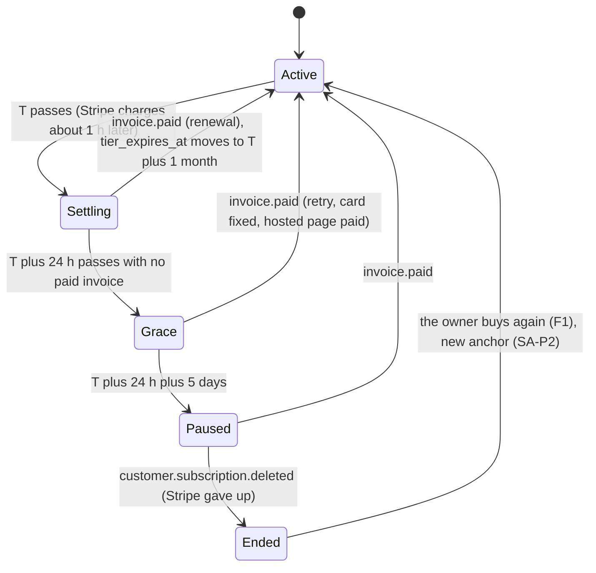

# Workplan: Business OS Plan Payments, P-6a (Renewal, failed payment, grace)

> **Last Updated**: 2026-10-15

**Developer:** Dev
**Requirement:** [BUSINESS_OS_PLAN_PAYMENTS_REQUIREMENT.md](/docs/requirements/BUSINESS_OS_PLAN_PAYMENTS_REQUIREMENT.md): F5, F6 (incl. the 3-D Secure and PF-10 notes), F8 row 3, §6 (retries, grace, paused, enforcement), §9.1 P-6a row, §9.1.2 (F-3, F-4, the standard sandbox), PF-1, PF-2, PF-10, PF-13, PF-14 (owner check only), SA-P2, SA-P8, SA-P16, SA-P17, C-6, C-8, C-10, C-11, AC-F5.1, AC-F5.2, AC-F6.1 to AC-F6.3, **AC-F6.5**; "P-4 workplan review (2026-10-13)" forward conditions **FC-1** and **FC-2**; "SA Ruling — P-4 and P-7b.1 sequencing" **U-10** (as extended 2026-10-13); the [P-7b.1 workplan](/docs/workplans/BUSINESS_OS_PLAN_PAYMENTS_P7B1_WORKPLAN.md) sandbox findings E-1b, E-2 and E-4.
**Depends on:** P-3b merged (#251, #299: apply function, money history, status mirror); P-5a merged (20261028 apply function); P-7b.1a merged (#346: `billingReason` on the facts, U-4). P-9 merged first by build order only (user, 2026-10-03).
**Date:** 2026-10-14
**Branch:** `feature/bos-plan-payments-p6a`, worktree `neuronforge-invite-s1`, fresh from `origin/main` `e7488400` (#384). Confirmed with `git branch --show-current` on 2026-10-14. Highest migration on that main: `20261068`.
**Status:** SA reviewed 2026-10-14: APPROVED WITH CONDITIONS C-1 to C-14 (SA Review Notes); split accepted. **P-6a.1 (T0 to T5) Code Complete 2026-10-15, uncommitted; SA code review 2026-10-15: APPROVED WITH FIXES, Code Approved for QA** (SA Code Review — P-6a.1; merge gate adds C-15). BQ-P12 decided by the user 2026-10-15: 5 days (§18). P-6a.2 (T6 to T11) not started: it branches from `origin/main` after P-6a.1 merges.

## Overview

P-6a makes a monthly renewal, and a renewal that fails, behave as F6 says, and makes it testable with Stripe test clocks.

- **Renewal.** Already built by P-3b: a paid renewal moves the paid-through date to Stripe's new period end and never moves the credit-period anchor. P-6a proves it on a test clock (AC-F5.1, AC-F5.2) and changes nothing in that path.
- **The two config numbers (C-10).** A 5-day grace entry (PF-1) and a 24-hour renewal settlement margin (PF-10) are **appended** as config history entries. Nothing already shipped is edited.
- **FC-1.** The margin extends the "is the tier in force?" test itself, so a renewing subscriber, including a dated Founding Partner, never flips to grace or back to Founding Partner in the hour before Stripe's renewal payment lands.
- **Failed renewal.** The failed attempt is counted on the billing record; the owner sees a banner on every Business OS page and a line in Settings → Plan. The account reads grace after the 24-hour margin, and paused 5 days later. A 3-D Secure renewal shows "Confirm your payment" with Stripe's hosted page.
- **Recovery and the end.** A paid retry or a fixed card returns the account to active. When Stripe gives up, the subscription is recorded as ended, with a money-history row and an audit entry, and the account stays paused (or, for a Founding Partner whose free access is still live, returns to Founding Partner: AC-F6.5).
- **U-10.** Every banner and attempt count reacts to **renewal** failures only. A declined or 3-D Secure **upgrade** never shows "your payment failed".
- **Test clocks from `/test-business-os`.** An admin can put their own test-mode Stripe customer on a fresh test clock, so the demo can move time.

**Production after merge:** the payment parts are inert, because both payment switches are off on Vercel and nothing is subscribed. **The lifecycle change is not behind a switch**: it is config, so it applies at merge to every plan row with a dated tier (admin-assigned ones included). It is recorded, not acted on, until S-5. §16 says exactly what moves and adds a read-only count as a merge gate.

**Size: about 4.1 dev-days**, over the row's 3d. A split into two PRs, never stacked, is proposed in §9: **P-6a.1 "Grace rules and renewal clock"** (≈ 1.9d) and **P-6a.2 "Failed payment: records and banners"** (≈ 2.2d).

**Migration: none expected** (§14). One business question (FC-2, §18).

---

## Table of Contents

1. [Analysis Summary](#1-analysis-summary)
2. [Scope](#2-scope)
3. [State Machine and Timings](#3-state-machine-and-timings)
4. [Stripe Events → Our Records → Lifecycle](#4-stripe-events--our-records--lifecycle)
5. [Implementation Approach](#5-implementation-approach)
6. [Files to Create / Modify](#6-files-to-create--modify)
7. [Gates](#7-gates)
8. [Task List](#8-task-list)
9. [Sizing and Split](#9-sizing-and-split)
10. [Tests](#10-tests)
11. [Sandbox Experiments and Fixtures](#11-sandbox-experiments-and-fixtures)
12. [Demo Plan](#12-demo-plan)
13. [Banners and Settings Wording (en / he / es)](#13-banners-and-settings-wording-en--he--es)
14. [Migration Check](#14-migration-check)
15. [Risks](#15-risks)
16. [Rollout and Rollback](#16-rollout-and-rollback)
17. [Questions for SA](#17-questions-for-sa)
18. [Business Question (FC-2)](#18-business-question-fc-2)

---

## 1. Analysis Summary

**Platform phase touched:** none of the V6 pipeline. Business OS entitlements lifecycle (config + `deriveLifecycle`), the webhook `plan` flow in `lib/business-os/billing/`, the billing-account repository, the Business OS layout (banner), Settings → Plan, and the `/test-business-os` harness.

### 1.1 As-built, read on `origin/main` `e7488400`

| Area | What exists | What P-6a needs | Evidence |
|---|---|---|---|
| Renewal apply | `business_os_apply_plan_payment` (20261028): money-history row, plan row `tier_expires_at = period_end` when the invoice is the newest by Stripe facts, anchor set **only** on the first plan-writing invoice of a subscription id (SA-P2, PF-2), billing row `current_period_end`, `last_invoice_id`, `last_paid_at`, `subscription_status` | Nothing. A test-clock demo and a captured renewal fixture prove AC-F5.1/AC-F5.2 | `20261028_business_os_first_payment_stamp.sql` lines 165-206 |
| Anchor rule for admin ops | `assign_tier` keeps the anchor while the billing record has a live subscription (PF-13, P-3b) | Nothing | P-3b |
| Failed invoice | `recordFailedPlanInvoice`: one `invoice_payment_failed` money-history row, **no billing write, no audit** (SA Q-2: "attempts, banner: P-6a") | Count renewal attempts on the billing row; audit renewal failures; never for an upgrade (U-10) | `planPaymentApply.ts` 843-877 |
| 3-D Secure renewal | `invoice.payment_action_required` is **not routed**: the resolver returns `not_business_os` for it | Route it to `plan`; store the hosted invoice URL; banner | `planInvoiceResolver.ts` 252-271 |
| Subscription mirror | `customer.subscription.updated/.deleted` copy `subscription_status`, `cancel_at_period_end`, `ended_at`, read fresh from Stripe, compare-and-set on the row holding the subscription. No history, no audit ("the 'ended' history and audit is P-6a's") | On `.deleted` (and any update that sets `ended_at` for the first time): one `subscription_ended` money-history row + audit | `planSubscriptionMirror.ts` |
| Billing record columns | `last_payment_failed_at`, `failed_attempts` (NOT NULL default 0, CHECK ≥ 0), `action_required_invoice_url` (CHECK `https://`, ≤ 2048), `subscription_status`, `current_period_end`, `ended_at`, `last_paid_at`; `service_role` column-level UPDATE on all of them | Written for the first time by P-6a | `20261025_business_os_billing_accounts.sql` lines 20-24, 54-56, 88; repository `BILLING_ACCOUNT_COLUMNS` already selects and maps all three failure columns (`BusinessOsBillingAccountRepository.ts` 107-109, 245-247) |
| Money-history kinds | CHECK admits `invoice_payment_failed`, `payment_action_required`, `subscription_updated`, `subscription_ended` from day one (SA-P5); `recordEvent` may write every kind except `invoice_paid` | Used for the first time: `payment_action_required`, `subscription_ended` | `20261027` line 31; `BusinessOsBillingEventRepository.ts` 72-90 |
| Lifecycle | `deriveLifecycle`: tier in force iff `tier_expires_at` is null or in the future (no margin); A-1 resumes a live cohort once the tier lapses; `settle()` grace = `historyAt(graceHistory, accessEndsAt)` days after the access end, admin pin `grace_ends_at` wins; a lapsed tier with an ended cohort takes the **cohort's** grace (champion 30 days) | Margin (PF-10) in the tier test (FC-1) and before grace; 5-day entry (PF-1) | `lifecycle.ts` 190-262, 361-386 |
| Grace config | `subscriptionGraceHistory = [{ effectiveFrom: 2026-09-22, days: 7 }]`; champion grace 30 days, trial grace 7 | Append `{ days: 5 }`; add a margin history | `config/lifecycle.ts` 25-28; `config/cohorts.ts` 140-142 |
| History guard (C-10, S-7) | `entitlements.snapshot.json` + `findDrift`: an edited or dropped history entry fails `tierMatrix.snapshot.test.ts`; an appended one does not | Add the margin history to the snapshot; refresh it with `npm run entitlements:snapshot` | `snapshot.ts` 155-176; `scripts/write-entitlements-snapshot.ts` |
| `past_due` lifecycle state | In the type and the overlay (`LIVE`), never emitted ("Slice 4") | **Stays unemitted** (SA-P8: grace is derived; `subscription_status` is display only). §17 Q-1 | `types.ts` 344; `config/lifecycle.ts` 54-56 |
| Owner banners | **None exist.** The layout reads only the plan pill (`readPlanBadge`) | A new server read + banner under the header | `app/business-os/layout.tsx` |
| Settings → Plan | P-4.2 `billingStateFromRecord`: `renewing` / `ending` from our record; **`past_due` returns `null`** (no sentence) | `payment_failed`, `action_required`, `ended` states | `planPurchaseView.ts` 112-144 |
| Card update | No Business OS portal route (F9, SA-P10 belong to P-7a) | The failed-payment banner cannot link to a portal yet. §5.7, §17 Q-6 | `app/api/business-os/billing/plan/` has `checkout`, `upgrade` only |
| Test clocks | Only `scripts/capture-stripe-billing-fixtures.ts` makes clocks (no metadata, not attached to an account) | "The test-mode customer is created on a test clock from `/test-business-os`" (P-6a row) | — |
| PF-14 / C-11 (refuse reset/deletion while subscribed) | Admin deletion refusal R-3 exists (`adminDeletionRefusals.ts` `isPlanSubscriptionLive`). Reset/purge refusal: **P-7a** owns it (§4 PF-14 row) | Nothing in P-6a. P-6a's ended mirror is what lets R-3 clear (`ended_at`) | `adminDeletionRefusals.ts` 119-123 |

**F-3 / AC-F6.5 confirmed in code (SA 2026-10-13):** the apply function never writes `cohort` or `cohort_expires_at`, the mirror never moves `tier_expires_at`, and A-1 resumes a live cohort once the tier lapses. So an ended Founding Partner subscription returns to Founding Partner with no new code; P-6a's job is to keep that true with the margin (FC-1) and to show it on screen.

**U-10 evidence in the captured fixtures:** the P-7b.1 sandbox captures (E-1b, E-2, E-4) show every upgrade failure carries `billing_reason: "subscription_update"`, and the subscription stays `status: "active"` throughout (`captured-p7b1-e2-event-customer-subscription-updated-*.json`, `captured-p7b1-e1b-*`, `captured-p7b1-e4-*`). E-2 also shows a declined upgrade invoice gets a Smart Retry about 45 h later, but Stripe voids it at about 23 h, so that retry never fires. These are the negative fixtures for U-10 (§10).

**Deprecated patterns found:** none extended. `StripeService.cancelSubscription` / `getSubscription` are legacy agent-platform helpers and are not used. No `console.*` in any file this slice touches (checked: both `lifecycle.ts`, `resolver.ts`, `report.ts`, `schema.ts`, `types.ts`, `planBillingHandler.ts`, `planPaymentApply.ts`, `planSubscriptionMirror.ts`, `planInvoiceResolver.ts`, `planInvoiceFacts.ts`, `planPurchaseView.ts`, `planPurchaseTypes.ts`, `BusinessOsBillingAccountRepository.ts`, `PlanSection.tsx`, `app/business-os/layout.tsx`, `BusinessOSHeader.tsx`, `app/test-business-os/page.tsx`, `StripeService.ts`, the webhook route, `lib/audit/events.ts`, `scripts/write-entitlements-snapshot.ts`).

**Schema claims (`business-os-schema-check`).** Every column above is read from the migration **body** (Rule 3), and all of them are already in `BILLING_ACCOUNT_COLUMNS`, which `findByUser` selects in production; 20261025's checker passed on production (2026-10-04, §9.1 P-3a row). Dev still runs `npm run schema:check` at T0 and records the ref and SHA (Rule 2), because a phantom column would only surface at the first failing select.

---

## 2. Scope

| In | Out (and where it lives) |
|---|---|
| PF-1: 5-day grace **appended** to `subscriptionGraceHistory` | Editing the 7-day entry (forbidden, C-10) |
| PF-10: `renewalSettlementMarginHistory` (24 h), applied by `deriveLifecycle` to a tier's access end, **including the tier-in-force test** (FC-1) | Margin on cohorts (trial, champion): PF-10 is "a tier's access end" |
| FC-2: stated; one business question (§18). Dev builds the recommended default unless the user decides otherwise | — |
| Renewal failures counted on the billing row (`failed_attempts`, `last_payment_failed_at`), renewal (`subscription_cycle`) invoices only (U-10) | Upgrade failures: unchanged (history row only, in-session answer from P-7b.1) |
| `invoice.payment_action_required` routed and recorded; hosted URL stored for renewals | Upgrade 3-D Secure: in-session (P-7b.1) |
| `subscription_ended` history row + audit on the end; audit for renewal failures and action-required | `subscription_updated` history rows for cancel / reactivate (P-7a, AM-7) |
| Owner banner on every Business OS page; Settings → Plan states `payment_failed`, `action_required`, `ended`; en/he/es (he/es drafts) | Portal "Update card" button (P-7a, F9). Invoice list (P-7a). Any money-history display (P-8a; U-10's display rule is carried there) |
| Test clock attach for the admin's own test-mode account from `/test-business-os` | Live mode (refused) |
| Test-clock demo of AC-F5.1, F5.2, F6.1 to F6.3, F6.5 | AC-F6.4 refunds/disputes (P-6b); AC-F8.x (P-7a); downgrade at renewal (P-7b.2) |
| Captured renewal fixtures (C-8 ratchet) | P-8b reconciliation of missed failure events |

---

## 3. State Machine and Timings

Two layers, decided in two places, never by a live Stripe call (SR-11):

- **Billing record** (`business_os_billing_accounts`): what Stripe says about the subscription, mirrored. Drives the **banner and Settings wording** only.
- **Lifecycle** (`deriveLifecycle`, pure, from the plan row and config): what the account is entitled to. Drives the **state** (active / grace / paused) and the **pill**. Recorded, not acted on, until S-5.

`T` = the paid-through date = `tier_expires_at` = the billing row's `current_period_end` (Stripe's period end, stored verbatim, PF-10). `M` = margin (1 day). `G` = grace (5 days for a subscription; see FC-2 for an ex-champion).



"Settling" is not a new state: the lifecycle reads `active` with reason `tier_in_settlement_margin`. "Ended" is not a lifecycle state either: the lifecycle stays `paused` (derived from `T`); "ended" is the billing record's `ended_at` and the banner's wording.

| Moment | Lifecycle (decided in `deriveLifecycle`) | Billing record (written by the webhook) | Banner / Settings (decided in `planPaymentNotice`, §5.6) |
|---|---|---|---|
| Before `T` | `active`, reason `tier_in_force` | `active` | none / "Renews on {T}" |
| `T` to `T + ~1 h` (Stripe finalises and charges) | `active`, reason `tier_in_settlement_margin` (FC-1) | `active` | none |
| Renewal paid | `active`, `tier_expires_at = T'` | `current_period_end = T'`, `last_paid_at`, failure columns cleared | none / "Renews on {T'}" |
| First failed attempt (`~T + 1 h`) | still `active` (margin) | `failed_attempts = 1`, `last_payment_failed_at`; status `past_due` (mirror) | **payment_failed** (no date) |
| 3-D Secure asked | still `active` (margin) | as above + `action_required_invoice_url` | **action_required** ("Confirm payment") |
| `T + 24 h` | **`grace`**, `graceEndsAt = T + 24 h + 5 d` | unchanged | payment_failed **with** "before {graceEndsAt}" |
| Stripe retries (Smart Retries, about two weeks, BQ-P7) | unchanged | `failed_attempts` = Stripe's `attempt_count` | unchanged |
| `T + 24 h + 5 d` | **`paused`** | unchanged | paused wording (§13; only once S-5 enforces; before that the payment_failed wording, §17 Q-5) |
| Any paid retry, hosted-page payment or card fix | `active` at once (`tier_expires_at = T'`) | status `active`, failure columns cleared | none |
| Stripe gives up (`T + ~14 d`) | stays `paused` | `subscription_status = canceled`, `ended_at`; `subscription_ended` history + audit | **ended** ("Choose a plan") |
| **Founding Partner, free access still live** | after `T + 24 h`: `champion` (A-1), pill back; never grace or paused (AC-F6.5) | as above | payment_failed while past due (it is their paid plan that failed), then ended; **no paused wording** |

**Where the timings come from:** `M` and `G` from config history (§5.1), looked up at `T`; the retry schedule and "cancel after all retries" from the Stripe dashboard (§9.5 row 11; on the standard sandbox it is a demo prerequisite, §12); `T` from Stripe.

**Margin on admin-assigned tiers:** harmless by design (PF-10 "all tiers"): an admin-dated tier keeps access 24 h longer than its date, then grace.

---

## 4. Stripe Events → Our Records → Lifecycle

All rows run after the router recognised a plan price and after PF-15's mode check. The account is always our billing row found by the subscription id, else the customer id, in this mode (SR-8); metadata is a cross-check only.

| Event | `billing_reason` | Money history | Billing record | Audit | Lifecycle effect |
|---|---|---|---|---|---|
| `invoice.paid` | `subscription_cycle` (renewal) | `invoice_paid`, `plan_written` (unchanged) | unchanged writes + **failure columns cleared** (§5.3) | `BOS_BILLING_INVOICE_PAID` (unchanged) | `tier_expires_at = T'` → active; anchor untouched (PF-2) |
| `invoice.paid` | `subscription_create`, `subscription_update` | unchanged (P-3b, P-7b.1) | unchanged + failure columns cleared when newer than the last failure | unchanged | unchanged |
| `invoice.payment_failed` | `subscription_cycle` | `invoice_payment_failed` (unchanged) | **`failed_attempts = attempt_count`, `last_payment_failed_at`** (order-safe, §5.3) | **`BOS_BILLING_PAYMENT_FAILED`** (new, warning) | none (derived from `T`) |
| `invoice.payment_failed` | `subscription_update` or anything else | `invoice_payment_failed` (unchanged) | **nothing** (U-10) | **none** (U-10; the owner's upgrade attempt is already audited as `BOS_BILLING_UPGRADE_REQUESTED`) | none |
| `invoice.payment_action_required` (new route) | `subscription_cycle` | **`payment_action_required`** | **`action_required_invoice_url`**, `last_payment_failed_at` (SA-P8: treated as failed) | **`BOS_BILLING_PAYMENT_ACTION_REQUIRED`** (new) | none |
| `invoice.payment_action_required` | `subscription_update` | **`payment_action_required`** row only (the record of what Stripe sent) | nothing (U-10) | none | none |
| `customer.subscription.updated` | — | none (unchanged, P-3b Q-1) | status, `cancel_at_period_end`, `ended_at` (unchanged) | none | none |
| `customer.subscription.deleted` | — | **`subscription_ended`** (new; once per event id) | status `canceled`, `ended_at` (unchanged) | **`BOS_BILLING_SUBSCRIPTION_ENDED`** (new) | none (stays paused, or the cohort resumes) |
| `invoice.voided`, `invoice.marked_uncollectible`, `invoice.created`, `invoice.upcoming` | — | not routed, not subscribed (SA-P8) | — | — | — |

**Void (E-4).** An unpaid upgrade invoice is voided by Stripe when its pending update expires (≈ 23 h). Nothing was written for it on the billing row (U-10), so nothing needs undoing. A renewal invoice voided by hand in the dashboard closes the failure through the status mirror (status leaves `past_due`), which is why the banner keys on status first (§5.6).

**Why `subscription_cycle` and not "not `subscription_update`".** A whitelist fails closed: a future `billing_reason` (e.g. `subscription_threshold`, `manual`) shows nothing rather than a false "your payment failed". A Founding Partner's first charge at `trial_end` (P-11, BQ-P2) is a `subscription_cycle` invoice, so its failure correctly shows the banner.

---

## 5. Implementation Approach

### 5.1 Config history entries (PF-1, PF-10, C-10)

`lib/business-os/entitlements/config/lifecycle.ts`:

```typescript
const SHIPPED = '2026-09-22T00:00:00.000Z';
// P-6a (PF-1, PF-10, C-10): appended, never edited. Set to the P-6a.1 merge
// date by Dev at commit time: a fixed literal, never `new Date()`.
const P6A_EFFECTIVE = '2026-10-16T00:00:00.000Z';

const subscriptionGraceHistory: readonly HistoryEntry[] = [
  { effectiveFrom: SHIPPED, days: 7 },
  { effectiveFrom: P6A_EFFECTIVE, days: 5 },
];

/** PF-10: 1 day = the 24-hour renewal settlement margin. */
const renewalSettlementMarginHistory: readonly HistoryEntry[] = [{ effectiveFrom: P6A_EFFECTIVE, days: 1 }];
```

- **Same mechanism as every lifecycle duration** (S-7): `HistoryEntry`, `historyAt`, the Zod `historySchema` (ascending, positive integers), and the drift snapshot. Not the `creditValue.history.json` pattern: that one versions a value that charge rows record by version; a lifecycle duration is looked up by date and has no row that names it.
- **Lookup key:** both at the tier's access end `T` (`historyAt(history, T)`), the key grace already uses. A tier that lapsed before `P6A_EFFECTIVE` keeps 7 days; one that lapses after gets 5. **For the margin**, `historyAt`'s "earliest entry when the moment predates every entry" rule applies the 24 h to older access ends too. Accepted on purpose: it only ever **extends** access, and S-7 protects against shortening a promise, not lengthening it (§17 Q-2).
- **Unit:** `days: 1` keeps the existing type, schema and drift comparator untouched. If SA wants an hours field, it is a new entry type and a `findDrift` change (+≈ 0.2d) (§17 Q-2).
- `LifecycleConfigShape`, `lifecycleSchema` (`renewalSettlementMarginHistory: historySchema`), `LifecycleInputs` (**required**, not optional: a caller that forgot it would silently drop FC-1), `resolver.ts` 200 and `report.ts` 769 pass it. The drift snapshot gains `subscription.margin`; `scripts/write-entitlements-snapshot.ts` writes it; `npm run entitlements:snapshot` regenerates the JSON (never hand-edited). The appended grace entry and the new margin history are additions, so `findDrift` reports nothing; the existing S-7 tests still catch an edit of the 7-day entry.

### 5.2 `deriveLifecycle` with the margin (FC-1, PF-10, AC-F6.5)

One new pure helper in `lifecycle.ts`, used by every branch that asks "is the tier in force?":

```typescript
/** When a dated tier's access really ends: its paid-through date plus the margin in force then (PF-10). */
export function tierSettlementEndsAt(tierExpiresAt: string, marginHistory: readonly HistoryEntry[]): string {
  const margin = historyAt(marginHistory, new Date(tierExpiresAt));
  return margin ? addDays(tierExpiresAt, margin.days) : tierExpiresAt;
}
```

| Branch | Today | After P-6a |
|---|---|---|
| Tier in force (RC-11) | `now < tier_expires_at` | `now < tierSettlementEndsAt(T)` (**FC-1**). Reason `tier_in_settlement_margin` when `T ≤ now < T + M`. `accessEndsAt` stays **`T` verbatim** (every display shows the paid-through date, PF-10 "store verbatim") |
| A-1: tier lapsed, cohort live | cohort resumes after `T` | cohort resumes only after `T + M`. A dated Founding Partner who renews never resumes Founding Partner in the hour before the renewal payment (FC-1). After an end, they resume Founding Partner after `T + M` (**AC-F6.5**) |
| A-1: tier lapsed, cohort ended or none | grace from `later(T, cohortEnd)` | **grace starts** at `later(T + M, cohortEnd)`; `accessEndsAt` still `later(T, cohortEnd)`; `graceEndsAt = graceStart + G` (`G` looked up at `accessEndsAt`, as today); the admin pin `grace_ends_at` still wins |
| Tierless cohort (trial, champion) | unchanged | unchanged: no margin |

`settle()` gains a `graceStartsAt` argument (defaults to `accessEndsAt`, so the cohort branch is byte-identical). `LifecycleResult` is unchanged in shape; only the new reason token is added (`shadow.ts` carries reasons as opaque strings).

**What else tests "tier in force", and whether it gets the margin** (§17 Q-3):

| Site | Purpose | Dev's proposal |
|---|---|---|
| `deriveLifecycle` | Entitlements, state, pill, every view built on the snapshot | **Margin** (the FC-1 fix) |
| `planWriteChecks.tierInForce` → `wouldLeaveNoBasis` (R2-3) | Refuses an admin op that would leave no basis | **Unchanged, strict.** Stricter is the safe side for a write guard: during the margin it refuses an op that would leave only a settling tier. No account is harmed |
| `app/api/admin/business-os/entitlements/launch/route.ts` 140 | Launch dry-run counts | Unchanged (a count; 24 h of difference is not a launch decision) |
| SQL `v_tier_in_force` in the apply function | Only decides whether `plan_version` is re-stamped | Unchanged, and not a migration: a renewal paid in the margin re-stamps `plan_version` to the current matrix version. That is B-10's own rule ("keep it until renewal"), so it is the intended behaviour, not a side effect. Recorded for SA |

### 5.3 Webhook: renewal failures and recovery (U-10)

**`planPaymentApply.ts` `recordFailedPlanInvoice`** keeps its history row for every failed plan invoice (unchanged). Then, **only when `facts.billingReason === 'subscription_cycle'`** (new constant `RENEWAL_BILLING_REASONS = ['subscription_cycle']`):

1. `billingAccounts.recordRenewalFailure({ userId, livemode, stripeSubscriptionId, failedAtIso: event.created, attemptCount: invoice.attempt_count })`.
2. On a **new** history row only (not `duplicate`): audit `BOS_BILLING_PAYMENT_FAILED` through `recordPlanChange` (system actor, `details`: invoice id, subscription id, `attemptCount`, `billingReason`, livemode; no email, no URL), `invalidatesEntitlements: false`, flushed bounded before the 200 (PF-11).

**New repository method `recordRenewalFailure`** (`{ count: 'exact' }`, **no `.select()`**, because UPDATE + `.or()` + `.select()` fails 42703 in production; the repository header already says so):

```text
UPDATE business_os_billing_accounts
SET failed_attempts = $attemptCount, last_payment_failed_at = $failedAt, updated_at = $now
WHERE user_id = $u AND livemode = $m AND stripe_subscription_id = $sub
  AND (last_payment_failed_at IS NULL OR last_payment_failed_at <= $failedAt)
  AND (last_paid_at IS NULL OR last_paid_at < $failedAt)
```

Order-safe both ways, on Stripe's timestamps, never arrival time: a failure delivered after the payment that cured it (`paid_at > failedAt`) writes nothing; an older failure delivered after a newer one writes nothing; a replay writes the same values. `attempt_count` is Stripe's own count, so a missed event never makes our count drift. The two-`or` filter shape is checked against PostgREST in T5's repository test (the 42703 note); if it is a problem, the method reads the row and does a compare-and-set on the values it read (§17 Q-4).

**Recovery: `afterApply`** (paid path), on `applied`, `recorded` **and** `already_applied` (so a crash between the commit and this write heals on Stripe's retry), calls `billingAccounts.clearRenewalFailure({ userId, livemode, stripeSubscriptionId, paidAtIso })`:

```text
SET failed_attempts = 0, action_required_invoice_url = NULL, updated_at = $now
WHERE user_id = $u AND livemode = $m AND stripe_subscription_id = $sub
  AND (last_payment_failed_at IS NULL OR last_payment_failed_at <= $paidAt)
```

`last_payment_failed_at` is kept: it is the "last failure" date P-8a's panel shows. The clear is **hygiene**, not the closing rule: the banner already closes on `last_paid_at > last_payment_failed_at` and on the status (§5.6), so a failed clear never shows a wrong banner. It never throws ("nothing after the apply may throw"): a failure is logged `warn` with the ids.

**Why not inside the apply function?** Atomic, but it means replacing `business_os_apply_plan_payment` (a migration with pre-check, checker, probe, rollback and a production apply gate) for a write that is order-safe and idempotent on its own. §14, §17 Q-4.

### 5.4 `invoice.payment_action_required` (3-D Secure renewal)

- **Resolver:** `planInvoiceResolver.ts` routes `invoice.payment_action_required` through `resolveInvoice`, like `invoice.payment_failed`, **but only while the price switch is on**. With the switch off it returns `not_business_os`, today's outcome, before any catalog load or Stripe call: going through `resolveInvoice` unguarded would turn today's `not_business_os` into an `unknown_price` deny (the empty catalog), a production behaviour change. Pinned by a test. The router table in the file header gains the row.
- **Handler:** `planBillingHandler.ts` gains `case 'invoice.payment_action_required': return recordActionRequiredPlanInvoice(...)`.
- **`recordActionRequiredPlanInvoice`** (new, `planPaymentApply.ts`): `checkInvoice(..., 'failed', log)` (same mode, account, metadata and customer checks); a `payment_action_required` history row for every plan invoice; then, for `subscription_cycle` only: `billingAccounts.recordActionRequired({ ..., failedAtIso: event.created, hostedInvoiceUrl })` (the same order-safe filter as §5.3, plus `action_required_invoice_url`), and on a new row an audit `BOS_BILLING_PAYMENT_ACTION_REQUIRED`.
- **The hosted URL** is a bearer link to the owner's invoice. It is shape-checked (`https://invoice.stripe.com/` prefix, ≤ 2048; else not stored, `warn`), **never logged, never audited, never in an error**, and sent only to that owner's browser (§5.6). A test spies on every logger and audit call (the P-7b.1 client-secret test pattern).
- **A plain decline on the same invoice after an action-required** keeps the URL: Stripe's hosted invoice page accepts a new card as well as the authentication, so "Confirm payment" still leads somewhere that settles the invoice. A failure on a **different** renewal invoice (next month) clears it (`recordRenewalFailure` sets `action_required_invoice_url = NULL` when the stored URL is not the event invoice's `hosted_invoice_url`).
- Experiment X-5 (§11) confirms that a 3-D Secure renewal also fires `invoice.payment_failed` and moves the subscription to `past_due`. If it does not move the status, §5.6's fallback rule covers it.

### 5.5 Subscription ended (AC-F6.3)

`planSubscriptionMirror.ts`, after a successful mirror (`mirrored: true`) of an event where Stripe's subscription has `ended_at` (whatever the event type, so a `.updated` that ends it counts too):

- `billingEvents.recordEvent({ kind: 'subscription_ended', stripeEventId, stripeSubscriptionId, stripeCustomerId, tier: account.boughtTier, ... })`. Unique on `stripe_event_id`, so a replay records nothing. Two events that both carry the end (`.updated` then `.deleted`) would write two rows; the audit is written only when the row is new **and** the billing row's `ended_at` was NULL before this mirror (the mirror returns the previous value: a one-field change to `mirrorSubscriptionState`'s result).
- Audit `BOS_BILLING_SUBSCRIPTION_ENDED` (system actor; `details`: subscription id, Stripe's `cancellation_details.reason` when present: `payment_failed` vs `cancellation_requested`, livemode).
- No plan write, no entitlement invalidation: the lifecycle derives from `T` (SA-P8).

### 5.6 One predicate for what the owner is told: `planPaymentNotice`

New pure module `lib/business-os/billing/planPaymentNotice.ts`, the **only** place that decides the banner and the Settings state, so they can never disagree (the `heldPaymentOffer` pattern):

```typescript
export type PlanPaymentNotice =
  | { kind: 'payment_failed'; failedAt: string; attempts: number; pauseBy: string | null; planLabel: string }
  | { kind: 'action_required'; failedAt: string; confirmUrl: string; planLabel: string }
  | { kind: 'paused'; planLabel: string }
  | { kind: 'ended'; endedAt: string; planLabel: string }
  | null;

export function planPaymentNotice(row: BillingRowFacts | null, lifecycle: LifecycleFacts, enforcing: boolean): PlanPaymentNotice;
```

| Rule | Why |
|---|---|
| `null` when there is no row, or the row is not in the server key's mode | PF-15 |
| **Failure open** = not ended AND (`subscription_status ∈ {past_due, unpaid}` OR (`last_payment_failed_at` set AND (`last_paid_at` null OR `last_payment_failed_at > last_paid_at`))) | The status is Stripe's truth read fresh (order-safe, and a declined or 3-D Secure **upgrade** never leaves `active`: E-1b, E-2, E-4 captures). The column branch covers a status event that has not landed yet. Both are U-10-safe, because the failure columns are written for `subscription_cycle` only |
| `action_required` when failure open AND `action_required_invoice_url` set | SA-P8 |
| `paused` when failure open AND lifecycle state `paused` AND `enforcing` | §6: paused is recorded, not acted on, until S-5. Before S-5 the banner never claims a pause that is not happening; it keeps the payment_failed wording (§17 Q-5) |
| `payment_failed` when failure open; `pauseBy = lifecycle.graceEndsAt` only while the state is `grace` | The date is the lifecycle's own answer, never recomputed here |
| `ended` when `ended_at` set AND the lifecycle state is `grace` or `paused` | A Founding Partner whose free access resumed (AC-F6.5) sees no "ended" banner: they lost nothing |
| Otherwise `null` | — |

**Banner read** `lib/business-os/billing/readPaymentNotice.ts` (`server-only`), the `readPlanBadge` guarantees copied as tests: no session → `null`; any throw → `null` (and `warn`); the account id through `resolveAccountId`. It reads the billing row by the **session** user id in the current mode (one indexed read) and the entitlement snapshot (the 30 s cached one the pill already reads). **Off unless `isPlanPriceRecognitionEnabled()`**: no read at all while the price switch is off, so production makes no new query and shows nothing (§16).

**Layout:** `app/business-os/layout.tsx` adds it to the existing `Promise.all` **after** the payment hold (F5b-4 order kept) and renders `<PlanPaymentBanner notice={...} />` inside the sticky wrapper under the tabs. `PlanPaymentBanner` (`components/business-os/billing/`) is a small client component for the translations: it renders what it is sent and decides nothing. Links: `action_required` → the hosted URL (`target="_blank" rel="noopener noreferrer"`); every other kind → `PLAN_SECTION_HREF` (`/business-os/settings?section=plan`).

### 5.7 Settings → Plan

- `PlanPurchaseBillingWire.state` gains `payment_failed` (`date` = `last_payment_failed_at`, `attempts`), `action_required` (`date`, `confirmUrl`) and `ended` (`date` = `ended_at`), computed by `billingStateFromRecord` **from `planPaymentNotice`** (one predicate), keeping `renewing` / `ending` exactly as P-4.2 ruled.
- `billingEndsWhen` maps them to `plan.payment_failed_on`, `plan.payment_action_required_on`, `plan.ended_on`; `PlanSection.tsx` renders the sentence (dates on the account's clock: the three keys join `ACCOUNT_CLOCK_SENTENCE_KEYS`) and, for `action_required`, a "Confirm payment" link; for `payment_failed`, the line `plan.update_card_email`.
- **No "Update card" button in P-6a.** The portal (F9, SA-P10) is P-7a's. Until it lands, Settings says where the link is (Stripe's failed-payment email, §9.5 row 10). P-7a replaces that line with its button. Pulling a portal button forward is §17 Q-6.
- `planUpgradeOffer` already refuses `past_due` (U-2): no change. The checkout already treats `past_due` / `unpaid` as live (SR-5) and an ended subscription as re-buyable: no change.

### 5.8 Test clock from `/test-business-os`

New admin route `POST /api/admin/business-os/test/plan-test-clock` (`new-api-route` skill):

- `requireAdmin` as the **first statement**; strict Zod body `{ action: 'attach' } | { action: 'advance', to: string /* ISO */ }`; Pino with `correlationId`; CLAUDE.md error format.
- **The account is the session's own** (the harness acts as the signed-in user, like the Plan checkout panel). No account id in the body.
- **Refused** (409, coded) unless: the server key's mode is **test** (`currentStripeMode()`; live → `live_mode_refused`); `isPlanCheckoutEnabled()` and `isPlanPriceRecognitionEnabled()` (both off on Vercel, so the route is inert in production); the account's billing row has **no live subscription** (`isPlanSubscriptionLive` false) and no unexpired checkout lock.
- `attach`: creates a test clock (`frozen_time` = now) and a new Stripe customer on it with the Business OS metadata (`product`, `bos_user_id`) and idempotency key `bos-customer-clock:<user id>:<clock id>`; records it with `recordCustomer` (no row) or the existing compare-and-set `replaceCustomer` (row exists, old customer id as read). Returns the clock id and frozen time.
- `advance`: reads the account's customer, refuses unless it has a `test_clock`, refuses a target in the past or more than 60 days ahead, calls `testHelpers.testClocks.advance`. Optional (§17 Q-7): the dashboard and CLI can advance a clock too.
- Pino `info` with the ids, plus a registered audit `BOS_BILLING_TEST_CLOCK_ATTACHED` (admin actor) because it replaces the account's Stripe customer.
- Harness: a "Test clock" block next to "Plan checkout (test)" in `app/test-business-os/page.tsx` (new `components/test-business-os/PlanTestClockPanel.tsx`): Attach, the clock id and time, and an Advance field.
- Route tests: 401/403 (non-admin), invalid body, live mode, switch off, live subscription, happy attach (both record paths), advance refusals.

### 5.9 Tenant isolation (`tenant-isolation-guard`)

| Path | Account from | Guard |
|---|---|---|
| Webhook failure / action-required / ended | our billing row by subscription id, else customer id, in this mode (SR-8) | metadata `bos_user_id` cross-check (existing `checkInvoice` / mirror step 3); every new UPDATE is `.eq('user_id').eq('livemode').eq('stripe_subscription_id')`, an explicit field allow-list, no caller payload |
| Banner, Settings | `getUser()` session id → `resolveAccountId` | the billing row read is `.eq('user_id', session)`; the hosted URL leaves the server only in that owner's response |
| Test clock route | `requireAdmin` + session id | no id from the request; a compare-and-set on the customer id read |

### 5.10 Entitlements registration (SR-17, `business-os-entitlements`)

| File (outside the module) | Imports | Registration |
|---|---|---|
| `lib/business-os/billing/readPaymentNotice.ts` | `resolveAccountId`, `getEntitlementService` | `KNOWN_NON_GATE_IMPORTERS`: reads the snapshot for display; refuses nothing |
| `lib/business-os/billing/planPaymentNotice.ts` | `LifecycleState` (type) or none (Dev passes plain facts to avoid the import; preferred) | registered only if it imports |
| `lib/business-os/billing/planPurchaseView.ts` | existing entry; symbols updated if they change | equality-checked |

No tier or capability literal is written anywhere (the plan label comes from `presentation`). `npm run test:bos-entitlements` on each PR's final diff, result recorded.

### 5.11 Audit (AM-7)

Three new `AUDIT_EVENTS` keys, registered in `events.ts` (definition + severity), `eventAudience.ts` (`'bos'`): `BOS_BILLING_PAYMENT_FAILED` (warning), `BOS_BILLING_PAYMENT_ACTION_REQUIRED` (warning), `BOS_BILLING_SUBSCRIPTION_ENDED` (info), plus `BOS_BILLING_TEST_CLOCK_ATTACHED` (info, admin actor). Entity `business_os_account_plan`, as the other plan-billing entries; owner-visible, which is correct here because every one is about the owner's own renewal (none is written for an upgrade, U-10). All webhook writes go through `recordPlanChange` (bounded flush before the 200, PF-11).

---

## 6. Files to Create / Modify

| File | Action | Reason | PR |
|---|---|---|---|
| `lib/business-os/entitlements/config/lifecycle.ts` | modify | Append the 5-day entry; add `renewalSettlementMarginHistory` (PF-1, PF-10) | .1 |
| `lib/business-os/entitlements/types.ts`, `schema.ts` | modify | `LifecycleConfigShape` + Zod field | .1 |
| `lib/business-os/entitlements/lifecycle.ts` | modify | `tierSettlementEndsAt`, FC-1, grace start, new reason | .1 |
| `lib/business-os/entitlements/resolver.ts`, `report.ts` | modify | Pass the margin into `LifecycleInputs` | .1 |
| `lib/business-os/entitlements/__tests__/lifecycle.test.ts`, `tierMatrix.snapshot.test.ts`, `freeAccess.test.ts`, `lib/business-os/billing/__tests__/planPurchaseView.test.ts` | modify | Required field in their inputs; FC-1, AC-F6.5, PF-1/PF-10 cases; snapshot histories | .1 |
| `lib/business-os/entitlements/__tests__/entitlements.snapshot.json` | regenerate | `npm run entitlements:snapshot` (never hand-edited) | .1 |
| `scripts/write-entitlements-snapshot.ts` | modify | Write `subscription.margin` | .1 |
| `app/api/admin/business-os/test/plan-test-clock/route.ts` (+ `__tests__/route.test.ts`) | create | Test clock attach/advance (§5.8) | .1 |
| `lib/stripe/StripeService.ts` | modify | `createBusinessOsTestClockCustomer`, `advanceBusinessOsTestClock` (test mode only) | .1 |
| `components/test-business-os/PlanTestClockPanel.tsx` (+ test), `app/test-business-os/page.tsx` | create / modify | Harness block | .1 |
| `docs/architecture/BUSINESS_OS_ENTITLEMENTS.md` | modify | Lifecycle: margin, 5-day grace, FC-1, FC-2 outcome | .1 |
| `lib/business-os/billing/planInvoiceResolver.ts` | modify | Route `invoice.payment_action_required` | .2 |
| `lib/business-os/billing/planBillingHandler.ts` | modify | New case | .2 |
| `lib/business-os/billing/planPaymentApply.ts` | modify | Renewal failure write + audit (U-10), action required, clear on paid | .2 |
| `lib/business-os/billing/planSubscriptionMirror.ts` | modify | `subscription_ended` row + audit | .2 |
| `lib/repositories/BusinessOsBillingAccountRepository.ts` (+ tests) | modify | `recordRenewalFailure`, `recordActionRequired`, `clearRenewalFailure`; `mirrorSubscriptionState` returns the previous `ended_at` | .2 |
| `lib/audit/events.ts`, `lib/audit/eventAudience.ts` | modify | Four new keys (one in .1) | .1/.2 |
| `lib/business-os/billing/planPaymentNotice.ts` (+ test), `readPaymentNotice.ts` (+ test) | create | One predicate; the layout read | .2 |
| `components/business-os/billing/PlanPaymentBanner.tsx` (+ test), `app/business-os/layout.tsx` | create / modify | The banner | .2 |
| `lib/business-os/billing/planPurchaseTypes.ts`, `planPurchaseView.ts`, `components/business-os/settings/PlanSection.tsx` | modify | Settings states | .2 |
| `lib/business-os/translations/en.ts`, `he.ts`, `es.ts` | modify | §13 keys | .2 |
| `lib/business-os/entitlements/__tests__/enforcementPoints.test.ts` | modify | Register `readPaymentNotice.ts` | .2 |
| `lib/business-os/billing/__tests__/fixtures/stripe/captured-p6a-*.json` | create | Renewal captures (§11) | .1 (capture) / .2 (used) |
| `app/api/stripe/webhook/__tests__/` (Connect harness entry, `planHandler.route.test.ts`) | modify | SR-10 evidence for the resolver change | .2 |
| `docs/requirements/BUSINESS_OS_PLAN_PAYMENTS_REQUIREMENT.md` | modify | P-6a row, Change History | both |

**Not touched:** any migration; `business_os_apply_plan_payment`; the checkout route and `planCheckout.ts`; `planUpgrade.ts`; `planInvoiceFacts.ts` (it already exposes `billingReason`; `attempt_count` and `hosted_invoice_url` are read from the invoice object in the handler); the Connect paths in the webhook route; `StripePaymentForm.tsx`.

---

## 7. Gates

| # | Gate | Before | Owner |
|---|---|---|---|
| G-1 | SA approves this workplan (incl. Q-1 to Q-8) | any code | SA |
| G-2 | FC-2 answered by the user, or the recommended default stands (§18) | P-6a.1 merge | User (via TL) |
| G-3 | **Production dated-tier count** (read-only, user, SQL editor), so the lifecycle change's reach is known before it merges: `select count(*) as dated_tiers, count(*) filter (where tier_expires_at < now()) as already_lapsed from public.business_os_account_plans where tier is not null and tier_expires_at is not null;` | P-6a.1 merge | User |
| G-4 | Sandbox experiments X-1 to X-6 run and recorded (§11); the sandbox's failed-payment settings recorded (retries, "cancel the subscription" after the last one) | T6 (P-6a.2 handler code) | TL supplies the key file location; Dev runs |
| G-5 | User approves the he/es drafts (§13) | P-6a.2 merge | User |
| G-6 | Demo (§12) run on the standard sandbox | P-6a.2 merge | TL / user |
| G-7 | `npm run test:bos-entitlements` green on each PR's final diff | each PR | Dev, then QA |

---

## 8. Task List

| # | Task | Est. | PR |
|---|---|---|---|
| ✅ T0 | **Done 2026-10-15.** Branch confirmed (`feature/bos-plan-payments-p6a` on `e7488400`). The merge of `origin/main` (`b5cd4a29`) was **refused by git** (the uncommitted requirement edit overlaps main's BQ-P9 change to the same file); not stashed, left for RM. `npm run schema:check` **not run**: it replays selects against the live database, and this session was told to make no Supabase call; the slice adds no selected column and the one new UPDATE writes only columns of the 20261025 grant (pinned by a test that reads the migration body). No migration (§14 confirmed) | 0.1d | .1 |
| ✅ T1 | **Done.** Config: append 5-day grace, add margin history, types, Zod schema, `LifecycleInputs` (required), resolver/report wiring, snapshot script + regenerate (`npm run entitlements:snapshot`; JSON diff = the two appended entries + `generated` only, C-9) | 0.35d | .1 |
| ✅ T2 | **Done.** `deriveLifecycle`: `tierSettlementEndsAt`, FC-1, grace start after the margin, new reason; **BQ-P12 (5 days, user 2026-10-15)**; tests: margin hour, FC-1 dated champion before renewal, AC-F6.5 (pill included), champion whose own end passed while paying (BQ-P12: 5 days), PF-1 at the entry boundary, admin pin wins, cohort branches unchanged | 0.45d | .1 |
| ✅ T3 | **Done.** Test clock: four `StripeService` methods (attach needs create + retrieve customer clock; status needs retrieve clock; advance), admin route (skill checklist, C-5 order), `attachTestClockCustomer` (C-6), `status` (C-7), harness panel, tests | 0.55d | .1 |
| ✅ T4 | **Done 2026-10-15.** Sandbox experiments X-1 to X-6 on the standard sandbox, 11 fixtures captured and scrubbed, every test clock deleted, Implementation Notes (§11) | 0.4d | .1 |
| ✅ T5 | **Done.** `docs/architecture/BUSINESS_OS_ENTITLEMENTS.md` lifecycle section; requirement row, §10.6 and Change History; `test:bos-entitlements` green (267 suites, 8017 tests) | 0.05d | .1 |
| | **P-6a.1 subtotal** | **≈ 1.9d** | |
| T6 | Repository: `recordRenewalFailure`, `recordActionRequired`, `clearRenewalFailure`, mirror's previous `ended_at`; unit tests incl. the order-safety matrix and the PostgREST filter shape | 0.4d | .2 |
| T7 | Webhook: renewal failure write + audit (U-10 whitelist), `payment_action_required` route + handler + URL handling (never logged), clear on paid (incl. `already_applied`), ended row + audit; audit keys; Connect harness entry | 0.6d | .2 |
| T8 | `planPaymentNotice` + `readPaymentNotice` + banner + layout; switch-off inert test | 0.45d | .2 |
| T9 | Settings → Plan states + `PlanSection` + en/he/es keys (drafts) | 0.35d | .2 |
| T10 | Captured-fixture test: the real code over the X-n captures and the P-7b.1 E-1b/E-2/E-4 upgrade captures (U-10 negatives) | 0.25d | .2 |
| T11 | Registration (`enforcementPoints.test.ts`), `test:bos-entitlements`, `lint:hooks`, docs, requirement row | 0.15d | .2 |
| | **P-6a.2 subtotal** | **≈ 2.2d** | |
| | **Total** | **≈ 4.1d** | |

The demo (§12) is TL's and the user's, not counted.

---

## 9. Sizing and Split

**≈ 4.1 dev-days** against the row's 3d. The difference: the test-clock harness the row asks for (0.55d), the sandbox experiments that must precede the handler code (0.4d), and the owner banner, which has no existing surface to extend (0.45d).

**Proposed split, two PRs, never stacked (SA decides):**

| PR | Title | Tasks | Est. | Demo on its own |
|---|---|---|---|---|
| **P-6a.1** | **Grace rules and renewal clock** | T0 to T5 | ≈ 1.9d | On a test clock attached from `/test-business-os`: a renewal moves the paid-through date and leaves the credit-period anchor (AC-F5.1, F5.2); with a failing card, the test clock's **Status** (the lifecycle at the clock's time, SA C-7; the Tiers page runs on real time and keeps reading `active`) reads `active` for 24 h after the period end, then `grace`, then `paused` 5 days later (AC-F6.1's lifecycle half); a retry with a good card returns `active` (AC-F6.2); Stripe giving up sets `ended_at` (already mirrored); a dated Founding Partner reads Founding Partner after their subscription ends (AC-F6.5), also from Status. No banner yet |
| **P-6a.2** | **Failed payment: records and banners** | T6 to T11 | ≈ 2.2d | The banner on a failed renewal, the 3-D Secure "Confirm payment" banner, attempts in Settings, the `subscription_ended` history and audit, and the U-10 negatives (a declined and a 3-D Secure upgrade show nothing) |

P-6a.1 is mostly config and lifecycle, and needs no webhook change: grace and paused are **derived**, so a failed renewal already reads grace and paused on the admin Tiers page once the margin and the 5-day entry are in. P-6a.2 branches from `origin/main` after P-6a.1 merges.

---

## 10. Tests

| Layer | What | Where |
|---|---|---|
| Pure, lifecycle | Margin hour (`T ≤ now < T + 1 d` → active, reason `tier_in_settlement_margin`); `T + 1 d` → grace; `T + 6 d` → paused; grace entry chosen at `T` across the `P6A_EFFECTIVE` boundary (7 vs 5); admin `grace_ends_at` pin wins; **FC-1**: dated champion with a live cohort reads `active` on the tier for the whole margin, never `champion`; **AC-F6.5**: same champion after an end reads `champion` after `T + M`, pill `Founding Partner` (`planBadgeFor`); champion whose own end passed while paying: grace length per FC-2; trial and open champion branches byte-identical (existing tests unedited) | `lifecycle.test.ts`, `planBadge.test.ts` |
| Config guard | The 7-day entry edited → `history_edited`; the appended entry and the margin → no finding; margin history schema refuses 0 and unsorted | `tierMatrix.snapshot.test.ts`, `schema` tests |
| Repository | `recordRenewalFailure` / `recordActionRequired` / `clearRenewalFailure`: invalid input; the order-safety matrix (older failure after newer; failure after its cure; replay; other subscription; other mode → 0 rows); `{ count: 'exact' }` and no `.select()` (source guard) | `lib/repositories/__tests__/` |
| Webhook orchestration | Renewal failure → row + billing write + one audit; replay → no audit; **U-10**: a `subscription_update` failure and a `subscription_update` action-required → history row, **no** billing write, **no** audit; unknown `billing_reason` → nothing; action-required URL in no log or audit (spy); paid clears on `applied`, `recorded`, `already_applied`, never throws; ended → one row + one audit, a second end event → no second audit | `planPaymentApply.test.ts`, `planSubscriptionMirror.test.ts` |
| Router | `invoice.payment_action_required` → `plan` with the switch on; **switch off → `not_business_os`, zero Stripe calls** (today's outcome); Connect harness snapshot unchanged (SR-10) | `planInvoiceResolver.test.ts`, `app/api/stripe/webhook/__tests__/` |
| Captured fixtures (C-8) | The real code over X-1 to X-5 (renewal paid, failed, action required, updated `past_due`, deleted) and over the P-7b.1 E-1b/E-2/E-4 upgrade captures: the upgrade ones write nothing to the billing row and produce `planPaymentNotice = null` | `planRenewal.captured.test.ts` |
| Notice predicate | Every row of §5.6's table; `paused` only when enforcing; `ended` hidden when a cohort resumed; mode mismatch → null | `planPaymentNotice.test.ts` |
| Banner read | No session → null; throw → null; switch off → null and **no repository call**; account through `resolveAccountId` | `readPaymentNotice.test.ts` |
| Components | Banner renders each kind in en/he/es, RTL for he; the confirm link opens the hosted URL with `noopener`; Settings sentences and the clock keys | `PlanPaymentBanner.test.tsx`, `PlanSection` tests |
| Route | Test clock: happy attach (both record paths), advance, 401, 403, invalid body, live mode, switches off, live subscription | `plan-test-clock/__tests__/route.test.ts` |
| Suites | `npm test` (affected), `npm run test:bos-entitlements`, `npm run lint:hooks`, `npm run typecheck:bos-llm` (0 new) | each PR |

**Happy path and one failure path** (CLAUDE.md, QA): renewal paid (happy) and renewal declined (failure) are both covered at the pure, orchestration and captured-fixture layers.

---

## 11. Sandbox Experiments and Fixtures

All on the **standard Stripe test account** `acct_1UPKR4C7KDUGYIcA` (§9.1.2). Its webhook does not forward to production. **TL supplies where its key file lives; Dev does not search for keys and never writes one into a file, a log or this document.** Experiments run from a scratch directory outside the repo, on customers created for them on test clocks, never on a real account's data. Stripe CLI 1.53 syntax for `stripe listen` (F-6). Events are captured as delivered (`2026-09-30.endive`, F-4); each fixture keeps its real `api_version` and a `_fixture_source` line, scrubbed as the P-3b C-6 capture was (email, name, address, hosted URLs, the `bos_user_id` value).

| # | Experiment | Question | Fixture |
|---|---|---|---|
| X-1 | Subscription on a test clock with `4242`; advance past the period end | When is the renewal invoice finalised and charged relative to the period end (PF-10's "about an hour")? `invoice.paid` shape for `subscription_cycle`; anchor unchanged | `captured-p6a-x1-*` renewal paid |
| X-2 | Default payment method swapped to `4000000000000341` (attaches, every charge fails); advance past the period end | `invoice.payment_failed` with `attempt_count`, `next_payment_attempt`; does `customer.subscription.updated` move to `past_due`, and in which order? | failed renewal + `past_due` update |
| X-3 | Swap back to `4242`; advance to the next retry, and separately pay the open invoice by hand | `invoice.paid` after failures; status back to `active`; the same period end `T'` | recovered renewal |
| X-4 | Leave it failing; advance past the last retry | `customer.subscription.deleted` (status `canceled`, `ended_at`, `cancellation_details.reason`) per the sandbox's "after all retries" setting | ended |
| X-5 | Default payment method `4000002760003184` (always authenticates, off-session too); advance past the period end | `invoice.payment_action_required` **and** `invoice.payment_failed`? `attempt_count`; status `past_due`? Then authenticate on the hosted page: `invoice.paid` | 3-D Secure renewal |
| X-6 | Read the sandbox's Billing → Revenue recovery settings (Smart Retries window, "cancel the subscription") | Recorded, not changed by Dev; if they differ from BQ-P7, TL asks the user | — |

**Decision rule:** if X-2 or X-5 shows the subscription does **not** move to `past_due` on a renewal failure, the column branch of §5.6 already covers it; Dev records it and SA confirms before T8. If X-1 shows Stripe charging more than 24 h after the period end, Dev stops and brings it to SA (the margin would be too short).

**Clean-up the same day:** `stripe subscriptions cancel sub_…`, `stripe customers delete cus_…`, `stripe test_helpers test_clocks delete clock_…`; the ids recorded in Implementation Notes.

---

## 12. Demo Plan

Standard sandbox (N-5 as updated: no production endpoint pause), local server, the designated test owner, the local switches (`BUSINESS_OS_PLAN_PRICES_ENABLED`, `BUSINESS_OS_PLAN_CHECKOUT_ENABLED`) on in `.env.local` only. **Prerequisite:** the sandbox's failed-payment settings recorded in X-6 (retries, then cancel).

| # | Step | Expected | AC |
|---|---|---|---|
| D1 | `/test-business-os` → Test clock → Attach; buy `basic` with `4242` | Tiers page `basic`, paid-through = period end `T`, anchor = billing date | AC-F1.1 (re-shown) |
| D2 | Advance the clock past `T` | `invoice.paid` renewal; paid-through `T'`; anchor unchanged; "Renews on {T'}" | AC-F5.1, F5.2 |
| D3 | Swap the card to `…0341`; advance past `T'` | Banner "Your last payment … didn't go through"; Settings "attempts so far: 1"; test clock **Status** `active`, reason `tier_in_settlement_margin` (C-7) | AC-F6.1 (banner) |
| D4 | Advance 24 h | Test clock **Status** `grace`, grace end `T' + 6 d` (C-7); banner's "before {date}" proved by the `planPaymentNotice` unit tests | AC-F6.1 (grace) |
| D5 | Advance 5 more days | Test clock **Status** `paused` (C-7); banner keeps the payment wording (not enforcing) | AC-F6.1 (paused) |
| D6 | Swap the card back to `4242`; pay the open invoice or advance to the next retry | Banner gone; `active`; paid-through `T''`; anchor unchanged | AC-F6.2 |
| D7 | New account (or after D6): `…3184` card; advance past the period end | "Confirm payment" banner; the link opens Stripe's hosted page; authenticate → `active` | P-6a row (3-D Secure) |
| D8 | Failing card again; advance past the last retry (X-4: about 14 days, 9 attempts) | `subscription_ended` row, audit; banner "Your Essentials subscription has ended"; test clock **Status** `paused` (C-7); Settings offers Choose (re-buy) | AC-F6.3 |
| D9 | A Founding Partner with an admin-set **future** end date buys `basic`, then the subscription ends (D8 path) | After `T + 24 h`, read from test clock **Status** (C-7): state `champion`, basis the cohort, no grace; the pill's return is pinned by a unit test (the real-time pill keeps the tier until real time passes `T`); no ended banner (the `planPaymentNotice` unit tests) | AC-F6.5 |
| D10 | U-10: a `basic` owner upgrades with the always-decline card, then with the 3-D Secure card and completes it | No banner at any point; Settings shows no failure; the 3-D Secure success leaves one `invoice_payment_failed` history row and no audit "payment failed" | U-10 |
| D11 | en / he / es | The banner and Settings lines in each; Hebrew right to left | §13 |

**After the demo, the same day:** cancel every demo subscription, delete the test customers and clocks; switches off and sandbox keys removed from `.env.local`; `git diff` shows nothing in env files; ids recorded (TL).

---

## 13. Banners and Settings Wording (en / he / es)

The plan name comes from `presentation` (never a literal). **he and es are DRAFTS for the user's approval (G-5).**

| Key | en | he (draft) | es (draft) |
|---|---|---|---|
| `billing.notice.payment_failed` | Your last payment for {plan} didn't go through. Please update your card to keep your plan. | התשלום האחרון עבור {plan} לא עבר. כדי לשמור על התוכנית, יש לעדכן את כרטיס האשראי. | Tu último pago de {plan} no se pudo procesar. Actualiza tu tarjeta para mantener tu plan. |
| `billing.notice.payment_failed_by` | Your last payment for {plan} didn't go through. Please update your card before {date} to keep your plan running. | התשלום האחרון עבור {plan} לא עבר. יש לעדכן את כרטיס האשראי עד {date} כדי שהתוכנית תמשיך לפעול. | Tu último pago de {plan} no se pudo procesar. Actualiza tu tarjeta antes del {date} para que tu plan siga activo. |
| `billing.notice.paused` (enforcing only) | Your {plan} plan is paused because we couldn't take your payment. Update your card to resume it. | התוכנית {plan} מושהית כי לא הצלחנו לגבות את התשלום. יש לעדכן את כרטיס האשראי כדי לחדש אותה. | Tu plan {plan} está en pausa porque no pudimos cobrar el pago. Actualiza tu tarjeta para reactivarlo. |
| `billing.notice.action_required` | Your bank needs you to confirm your payment for {plan}. | הבנק מבקש אישור לתשלום עבור {plan}. | Tu banco necesita que confirmes el pago de {plan}. |
| `billing.notice.confirm_payment` | Confirm payment | לאישור התשלום | Confirmar pago |
| `billing.notice.ended` | Your {plan} subscription has ended. Choose a plan to continue. | המנוי ל־{plan} הסתיים. כדי להמשיך, יש לבחור תוכנית. | Tu suscripción a {plan} ha terminado. Elige un plan para continuar. |
| `billing.notice.open_plan` | Plan settings | להגדרות התוכנית | Configuración del plan |
| `plan.payment_failed_on` | Your payment on {date} didn't go through. Stripe will try again automatically (attempts so far: {count}). | התשלום מתאריך {date} לא עבר. Stripe ינסה לגבות שוב באופן אוטומטי (ניסיונות עד כה: {count}). | Tu pago del {date} no se pudo procesar. Stripe lo intentará de nuevo automáticamente (intentos hasta ahora: {count}). |
| `plan.update_card_email` | To update your card, use the link in the email Stripe sent you. | לעדכון הכרטיס, יש להשתמש בקישור שבמייל שנשלח מ־Stripe. | Para actualizar tu tarjeta, usa el enlace del correo que te envió Stripe. |
| `plan.payment_action_required_on` | Your bank asked you to confirm the payment due on {date}. | הבנק ביקש אישור לתשלום שמועדו {date}. | Tu banco te pidió que confirmes el pago con vencimiento el {date}. |
| `plan.ended_on` | Your subscription ended on {date}. | המנוי הסתיים ב־{date}. | Tu suscripción terminó el {date}. |

Hebrew follows the existing Settings → Plan tone (impersonal: "יש לעדכן", "לאישור התשלום", as `plan.choose.*` does). The banner sits in the RTL owner layout (`OwnerDirScript`), with the dates on the account's clock. `plan.update_card_email` is removed by P-7a when its "Update card" button lands.

---

## 14. Migration Check

**Verdict: no migration.**

| Need | Exists | Evidence |
|---|---|---|
| Failure columns on the billing row | `last_payment_failed_at`, `failed_attempts`, `action_required_invoice_url`, `ended_at`, `subscription_status`, `current_period_end`, `last_paid_at` | 20261025 body lines 20-24; CHECKs 46, 54, 56; applied to production (checker passed, 2026-10-04) |
| `service_role` may UPDATE them | column-level UPDATE on all 17 columns incl. these | 20261025 line 88 |
| History kinds `payment_action_required`, `subscription_ended` | in the `kind_known` CHECK; `recordEvent` may write them | 20261027 line 31; repository 72-90 |
| Grace and margin | config, not database | §5.1 |
| Clearing failures on payment | TypeScript, order-safe, idempotent (§5.3) | — |

**If SA prefers** the clear inside `business_os_apply_plan_payment` (atomic with the payment, §17 Q-4), that is a `DROP` + re-create of the function at the **next free number at Dev time**, after the highest on `origin/main` **and** every remote branch (today's `origin/main` highest is `20261068`; 20261061 and 20261063 to 20261065 are absent on main and may be reserved elsewhere, so Dev checks with `git ls-tree` on every remote branch, as P-9 did). It would ship with a pre-check, checker, rolled-back probe and rollback, all run on a local PGlite, and the user applies it by hand before merge. **Paste rules for any user-pasted SQL:** no `--` comments, no punctuation inside string literals, and never the word "into" anywhere in the pasted text (the editor breaks on it, memory note). The P-3b checker's rows 81/83 and the 20261028 checker's C3 md5 would then read FAIL by design and need noting, as 20261028 did. Dev recommends against it.

---

## 15. Risks

| # | Risk | Severity | Mitigation |
|---|---|---|---|
| R-1 | The lifecycle change is live at merge for every dated tier in production (admin-assigned), and changes the admin Tiers state, finance groups and shadow report for them | Medium | Recorded, not acted on (shadow mode); G-3 count before merge; only ever adds 24 h of access; the 5-day entry applies only to access ending after `P6A_EFFECTIVE` |
| R-2 | Stripe charges more than 24 h after the period end (e.g. a finalisation delay on a failing endpoint) and a healthy subscriber reads grace | Medium (post S-5) | X-1 measures it; `invoice.created` stays unsubscribed (SA-P8: avoids Stripe's 72 h hold); a later margin entry can be appended (C-10) |
| R-3 | A banner for an upgrade failure (U-10 broken) | High | Whitelist `subscription_cycle`; status branch is upgrade-safe (captures); U-10 negatives over the real E-1b/E-2/E-4 payloads; a declined upgrade's Smart Retry (E-2, ≈ 45 h) is voided at ≈ 23 h and would be `subscription_update` anyway |
| R-4 | The hosted invoice URL leaks into logs or audit | Medium | Never logged or audited; spy test; served only in the owner's own response |
| R-5 | PostgREST rejects the two-`or` UPDATE filter (42703 family) | Low | `{ count: 'exact' }`, no `.select()`; repository test against the real client shape; fallback compare-and-set (§17 Q-4) |
| R-6 | An extra billing read on every Business OS page | Low | Only while the price switch is on; one indexed read by `(user_id, livemode)`; `null` on any failure |
| R-7 | "Update your card" with no in-app way to do it until P-7a | Low (inert in production; P-7a is on the go-live floor) | Settings points to Stripe's email (§9.5 row 10); 3-D Secure has its own link; §17 Q-6 |
| R-8 | `subscription_ended` written twice when `.updated` and `.deleted` both carry the end | Low | Rows are per event (append-only history); the audit is written once, on the first end (`ended_at` was NULL before) |
| R-9 | During the margin hour, Settings shows the dateless "while paid" line because `billingStateFromRecord` needs a future period end | Low | Cosmetic, under an hour a month; left as P-4.2 ruled |
| R-10 | Test clocks: a clock allows few customers and its subscriptions only move when the clock moves | Low | One clock per attach; the harness shows the clock id and time; clean-up deletes it |
| R-11 | Founding Partner with a failed renewal sees "payment failed" while back on Founding Partner after the margin | Low | True (their paid plan failed); no "paused" or "ended" wording for them (§5.6) |

---

## 16. Rollout and Rollback

**Production after P-6a.1 merges:**
- **Live:** the 5-day grace entry and the 24-hour margin, for every plan row with a dated tier (admin-assigned today; no live subscriptions exist). Effect: such an account reads `active` for 24 h past its tier end, then grace for 5 days (if its tier ends after `P6A_EFFECTIVE`) instead of 7. Recorded, not acted on: enforcement is `shadow`. G-3 counts them first.
- **Inert:** the test-clock route (404/refused while both payment switches are off, and refused in live mode).

**Production after P-6a.2 merges:** inert. The banner read and the Settings states do nothing while `BUSINESS_OS_PLAN_PRICES_ENABLED` is off (no query is made); the webhook changes run only for events the plan router recognises, which it does not while the switch is off; `invoice.payment_action_required` keeps today's `not_business_os` outcome with the switch off.

**Rollback:** revert the PR. P-6a.1's history entries are config: a revert removes them, which the drift snapshot will flag as `history_edited` until the snapshot is regenerated, deliberately so (the revert is a decision and the snapshot diff records it). P-6a.2 writes only existing columns and existing history kinds; rows it wrote stay valid for the reverted code (nothing reads them).

**Go-live (§9.5):** rows 10 (Stripe failed-payment and authentication emails, which `plan.update_card_email` relies on) and 11 (retries then cancel) are what make the production behaviour match this demo.

---

## 17. Questions for SA

| # | Question | Dev's proposal |
|---|---|---|
| Q-1 | Keep the `past_due` lifecycle state unemitted, with grace purely derived (SA-P8)? | Yes. The billing record carries Stripe's status for the banner; the lifecycle stays a pure function of the plan row and config |
| Q-2 | Margin as `HistoryEntry { days: 1 }` with one entry at `P6A_EFFECTIVE`, which (through `historyAt`'s earliest-entry rule) also extends access ends before that date? | Yes: no type or comparator change, and it only lengthens access. Alternative: an `hours` entry type (+0.2d) |
| Q-3 | FC-1 scope: margin in `deriveLifecycle` only; `planWriteChecks.tierInForce` (R2-3), the launch dry run and the SQL `plan_version` test unchanged (§5.2 table)? | Yes |
| Q-4 | Clear failure columns on payment in TypeScript after the apply (idempotent, order-safe, never throws), not inside the apply function (a migration)? And the two-`or` UPDATE filter, or read-then-compare-and-set? | TypeScript; the filter, with the fallback if the repository test shows 42703 |
| Q-5 | Before S-5, never show "paused" wording (keep the payment-failed wording while the lifecycle reads paused), keyed on the entitlements mode? | Yes: §6 says paused is recorded, not acted on, and the banner must not claim a restriction that is not happening |
| Q-6 | No portal "Update card" in P-6a; Settings points to Stripe's email until P-7a? Or pull a minimal portal session route forward (+≈ 0.75d, the SA-P10 configuration script included)? | Keep it in P-7a |
| Q-7 | Test clock `advance` in the harness, or attach only (advance in the Stripe dashboard)? | Both (advance is ≈ 0.1d of the 0.55d and makes the demo self-contained) |
| Q-8 | Audit only renewal failures (U-10), entity `business_os_account_plan` (owner-visible), and record a `payment_action_required` history row for upgrades too (with no billing write and no audit)? | Yes. The history is the record of what Stripe sent; U-10's display rule binds P-8a's money-history view, carried there |

**Carried forward:** U-10's extension (a successful 3-D Secure upgrade leaves one `invoice_payment_failed` row) binds any money-history display. P-6a builds none; P-8a (AM-1) and P-7a's invoice list (which reads Stripe invoices, not history) must label it by `billing_reason`, not by the row's kind.

---

## 18. Business Question (FC-2)

**What it is about.** A Founding Partner whose free access has an end date can start paying (BQ-P10). If that end date passes while they are paying, and later one of their renewal payments fails, the system has to decide how long they get before their account is paused.

**What is built today.** They get the **Founding Partner grace: 30 days**, not the 5 days every other paying customer gets after a failed payment. The code chose this on purpose ("having been a Founding Partner should not make their lapse worse"). It only affects someone who was both a Founding Partner and a paying customer, and only after their free access has already ended. (A Founding Partner whose free access is still running goes back to Founding Partner instead, with no grace and no pause: AC-F6.5.)

| # | Question | Recommended default | Why |
|---|---|---|---|
| **BQ-P12** | **When a former Founding Partner who now pays has a renewal payment fail, how long before their account is paused: 30 days (as for Founding Partners) or 5 days (as for every paying customer)?** | **Keep 30 days.** | They are our design partners and a very small group; generosity costs little and avoids a hard moment with people we want to keep. Stripe keeps retrying for about two weeks either way, and nothing is actually paused until enforcement is switched on (S-5). Choosing 5 days instead is a one-line change in the same slice |

Dev builds the recommended default unless the user decides otherwise (G-2). If the user chooses 5 days, `deriveLifecycle` uses the subscription grace whenever the basis is a lapsed tier, and the comment and test change with it.

**DECIDED by the user 2026-10-15: "5 days, like every paying customer"** (requirement §10.6; G-2 met; FC-2 closed). Built in P-6a.1, see Implementation Notes (P-6a.1) for the exact rule.

---

## SA Review Notes

**Reviewed by SA — 2026-10-14**
**Status:** ✅ APPROVED WITH CONDITIONS (C-1 to C-14 below). Split accepted: two PRs, never stacked.

Checked against the worktree on `feature/bos-plan-payments-p6a` (`e7488400`, workplan uncommitted): `lifecycle.ts` (`historyAt`, the tier-in-force branch, A-1, `settle`), `config/lifecycle.ts`, `snapshot.ts` `findDrift`, `scripts/write-entitlements-snapshot.ts`, `tierMatrix.snapshot.test.ts`, `report.ts` `lifecycleInputs` (also used by `finance/planGroups.ts`), `planWriteChecks.ts`, `planInvoiceResolver.ts`, `planPaymentApply.ts` `recordFailedPlanInvoice`, `planSubscriptionMirror.ts`, `BusinessOsBillingAccountRepository.ts` (header, `replaceCustomer`, `mirrorSubscriptionState`), `planPurchaseView.ts` `billingStateFromRecord`, `adminDeletionRefusals.ts` `isPlanSubscriptionLive`, the 20261025 body (columns and the column-level `GRANT UPDATE`, line 88) and the 20261028 apply function body, `lib/audit/events.ts`, the take-credits admin test route, and the `business-os-entitlements`, `new-api-route`, `tenant-isolation-guard` and `business-os-schema-check` skills. Every schema claim in §1.1 and §14 holds against the migration bodies (Rule 3); T0's `schema:check` run is still required (Rule 2).

The design is sound and correctly phased: grace stays derived (SA-P8), FC-1 is fixed in the one function that answers "is the tier in force?", AC-F6.5 needs no new code, U-10 is a fail-closed whitelist, and `invoice.payment_action_required` keeps today's outcome with the switch off (SR-10). Two things in the plan would not work as written, both caused by Stripe test clocks moving Stripe's time and not ours (C-1, C-7), and one stale-column trap in the test-clock attach (C-6). None changes the architecture.

### Rulings on Q-1 to Q-8

| # | Ruling |
|---|---|
| **Q-1** | **Yes.** `past_due` stays unemitted; the lifecycle stays a pure function of the plan row and config; Stripe's status lives on the billing row for display only (SA-P8). |
| **Q-2** | **Yes: `HistoryEntry { days: 1 }`, one entry.** No hours type. The earliest-entry rule retro-applying the margin to access ends before `P6A_EFFECTIVE` is accepted: it only lengthens access (also: an already-lapsed row's grace end moves one day later; never earlier). S-7 forbids shortening a promise, not lengthening one. The **grace** entry is the opposite case and gets C-8. |
| **Q-3** | **Yes: margin in `deriveLifecycle` only.** `planWriteChecks.tierInForce` stays strict (a write guard errs on refusing); the launch dry run stays a raw count; the SQL `v_tier_in_force` stays as is. Recorded: because Stripe charges about an hour after `T`, a normal renewal already finds `v_tier_in_force` false and re-stamps `plan_version` today, with or without the margin. That is B-10's "until renewal" rule, so intended. Every other reader of the state (`resolver.ts`, `report.ts`, `finance/planGroups.ts` through `lifecycleInputs`) gets the margin automatically because `LifecycleInputs` makes it required. |
| **Q-4** | **TypeScript, not a new apply function (no migration).** But the write shape changes: C-2 (read, decide in a pure function, compare-and-set on the values read; no `.or()`), and the comparisons need one time base: C-1. |
| **Q-5** | **Yes.** No "paused" wording until the effective entitlement mode is `enforce`; until then the payment-failed wording stays while the lifecycle reads paused. `enforcing` is the server-resolved effective mode, never a client value. |
| **Q-6** | **Keep the card-update button in P-7a. Not a business question:** production is inert (both switches off, no live subscriptions), and P-7a is on the technical go-live floor (§9.1 "Technical go-live floor", §9.5 row 1), so no paying customer can ever see "use the link in Stripe's email" without an in-app button already shipped beside it. If the go-live floor ever drops P-7a, this returns as a question then. Note for the demo: Stripe test mode does not reliably send customer emails, so the demo never depends on that email. |
| **Q-7** | **Both attach and advance in the harness**, plus a read-only `status` action (C-7). Advance refuses a past target and more than 60 days ahead; a Stripe refusal of the advance (its own interval limit) maps to a coded 409, never a 500. |
| **Q-8** | **Yes** to all three: audit renewal failures and renewal action-required only (U-10); entity `business_os_account_plan`, audience `'bos'`; a `payment_action_required` history row for an upgrade too, with no billing write and no audit. Severity per C-10. The U-10 display rule is carried to P-8a (AM-1) and P-7a's invoice list, as §17 says. |

### Other questions the TL asked SA to rule on

- **P-6a.1's production impact: acceptable**, under shadow mode, with C-8 and C-11. What moves at merge: dated tiers read `active` for 24 h past their date (only lengthens), a lapsed tier's grace end moves one day later (only lengthens), and a tier whose date falls **after** `P6A_EFFECTIVE` gets 5 days of grace instead of 7 (PF-1, a decided requirement, applies to admin-dated tiers by design since there is only one tier grace). Nothing is enforced; the admin Tiers state, the finance groups and the shadow report change for those rows only.
- **U-10: correct as designed.** The `subscription_cycle` whitelist on every billing-row write and audit fails closed for any future `billing_reason`; the banner's status branch is upgrade-safe on the evidence (E-1b, E-2 and E-4 captures: an upgrade decline or 3-D Secure leaves `status: active`); the column branch can only be fed by renewal writes. A Founding Partner's first charge at `trial_end` (P-11) is `subscription_cycle` and correctly shows the banner.
- **`invoice.payment_action_required` behind the price switch: required, as designed.** `resolveInvoice` with the switch off denies loudly (`unknown_price` / `no_priced_lines`), which would be a production behaviour change for an event that today returns `not_business_os`. The new `case` returns `NOT_OURS` when `recognitionEnabled()` is false, before any catalog read or Stripe call, pinned by a test with zero Stripe calls, and the Connect harness snapshot unchanged.
- **Entitlements registration and config rules:** C-9, C-12.
- **Tenant isolation and the new-api-route skill for the test-clock route:** C-5, C-6.
- **Schema check:** passed on the migration bodies (above); T0 runs `npm run schema:check` and records the ref and SHA.

### Conditions

**P-6a.1 (T0 to T5)**

- **C-5 Test-clock route shape** (`new-api-route`, `tenant-isolation-guard`, CLAUDE.md admin gate). Order, as the take-credits test route does: `requireAdmin` as the first statement (401/403) → either switch off: **404 `not_enabled`** (the route looks absent; not 409) → Zod `.strict()` discriminated union `attach | advance | status`, each with **`accountId: z.string().uuid()`** → the account through `resolveAccountId` + `isBusinessOsTenant` (404 `not_a_tenant`) → server key mode test, else **409 `live_mode_refused`** → billing-row refusals (live subscription, unexpired checkout lock: 409, coded) → Stripe. **Why `accountId` in the body, reversing §5.8's "the session's own account":** the harness is open to every signed-in account and the demo owners (D1, D9's Founding Partner) are not admins, so a session-only admin route could only ever clock the admin's own account. The panel pre-fills the session's account id; the admin may target their own account (test mode only, unlike take-credits). The two new `StripeService` methods **refuse a non-`sk_test_` key themselves**, before any Stripe call (defence in depth, tested). `advance` and `status` check that the stored customer has a `test_clock` and that its `bos_user_id` metadata is the target account, else 409. Audit `BOS_BILLING_TEST_CLOCK_ATTACHED` (admin actor, target entity) through the bounded flush (WC-7). Pino with `correlationId`; ids only; CLAUDE.md error format. Route tests add: switch off → 404 with no repository or Stripe call; non-tenant account; foreign clock; Stripe advance refusal → 409.
- **C-6 Attach resets the whole subscription mirror.** `replaceCustomer` clears only the subscription id, status and lock; it keeps `ended_at`, `cancel_at_period_end`, `current_period_end`, `last_paid_at`, `last_invoice_id`, `bought_tier`, `pending_tier` and the three failure columns. On an attach that replaces a row whose last subscription ended (exactly the rows the route allows), that breaks two things: a stale `ended_at` makes `isPlanSubscriptionLive` false for the next subscription and hides its failures from `planPaymentNotice` (apply clears `ended_at` only on a replacement, and the new subscription is not one); and a stale clock-future `current_period_end` from a previous demo makes the apply function's `v_newest` false, so the next purchase on a fresh clock **is not written to the plan row**. So attach uses a new repository method (compare-and-set on the old customer id, `{ count: 'exact' }`, no `.select()`, no `.or()`) that sets the new customer and clears every subscription-scoped column the 20261025 grant lists (subscription id, status, `bought_tier`, `current_period_end`, `cancel_at_period_end`, `pending_tier`, lock, `last_invoice_id`, `last_paid_at`, `last_payment_failed_at`, `failed_attempts = 0`, `action_required_invoice_url`, `ended_at`); `founder_discount_applied_at` is left alone. Production `replaceCustomer` is **not** changed in P-6a (follow-up F-1). Unit tests for the method; the route test covers both record paths.
- **C-7 The lifecycle runs on the real clock; a test clock moves only Stripe.** After an advance, `tier_expires_at` is in the real future, so the admin Tiers page (and the banner's grace-dependent parts) keep reading `active`. §9's P-6a.1 demo and §12 D3 to D5, D8 and D9 cannot be shown on the Tiers page as written. Fix: the route's read-only **`status`** action returns the clock's frozen time, the billing row's failure fields (never the hosted URL), and `deriveLifecycle(plan row, lifecycleInputs(config), clock frozen time)` (state, reason, `accessEndsAt`, `graceEndsAt`). The panel shows it; the demo reads AC-F6.1's lifecycle half, AC-F6.2 and AC-F6.5 from it. `pauseBy` ("before {date}") and the `ended`-vs-cohort rule are proved by the `planPaymentNotice` unit tests, not live. Dev corrects §9 and §12 in this workplan before T3. The route becomes an importer of the module: C-12.
- **C-8 `P6A_EFFECTIVE` is never earlier than the moment P-6a.1 merges.** An appended grace entry dated before the merge would retroactively give 5 days to tiers that lapsed between that date and the merge, while their 7-day grace is already running: a shortened promise (S-7), which the drift check cannot see. Fixed ISO literal, never `new Date()`; RM checks at merge time that it is in the future and, if not, Dev bumps it and regenerates the snapshot before merging. The margin entry shares the literal (harmless either way).
- **C-9 Snapshot rules.** `subscription.margin` is added to the snapshot script, to the test's `currentConfig()` (both places at lines 41 and 215 of `tierMatrix.snapshot.test.ts`) and to the non-vacuity check, or an edit of the margin would never be caught. Regenerate only with `npm run entitlements:snapshot`; never hand-edit the JSON; never `jest -u` (or `--updateSnapshot`) on any entitlements suite. Before committing, the JSON diff must show only the appended grace entry, the new margin history and the `generated` date; anything else is drift and stops the work. Tests add: margin edited → `history_edited`; margin schema refuses 0 and unsorted.
- **C-11 Gate G-3 extended, with a pass rule.** The user runs, read-only, in the SQL editor (no comments, no punctuation in literals, the editor-breaking word avoided):
  - `select count(*) filter (where tier_expires_at is not null) as dated_tiers, count(*) filter (where tier_expires_at <= now()) as already_lapsed, count(*) filter (where tier_expires_at > now() - interval '1 day' and tier_expires_at <= now()) as in_margin_now, count(*) filter (where tier_expires_at > now()) as lapse_later from public.business_os_account_plans where tier is not null;`
  - `select count(*) as live_mode_subscriptions from public.business_os_billing_accounts where livemode and stripe_subscription_id is not null and ended_at is null;`

  **Pass:** `live_mode_subscriptions = 0` (no paying customer is touched), and the admin Tiers page shows the production entitlement mode as shadow or off. The four counts are informational: any value is acceptable, and they are recorded in the requirement's P-6a row. A non-zero live-mode count stops the merge and comes back to SA.
- **G-2 (BQ-P12)** stays as written: the default is the as-built 30 days (no code change). If the user chooses 5 days, it is the one-line change in `deriveLifecycle` plus its test, inside P-6a.1, before merge.

**P-6a.2 (T6 to T11)**

- **C-1 One time base for "failure vs payment".** §5.3 compares `event.created` (the failure) with `last_paid_at` (the invoice's `status_transitions.paid_at`). Under a test clock the invoice's timestamps are in the clock's time; whether `event.created` is too is not established. If they differ, a failure after a clock advance is wrongly treated as "cured" (or the banner never closes). X-2, X-3 and X-5 must record, for each captured event, `event.created`, the invoice's `status_transitions.*` and the clock's `frozen_time`. Then: if `event.created` is in the clock's time, §5.3 stands. If not, the cure is decided by **periods**: a renewal failure on an invoice whose period ends at `P` is moot when `current_period_end >= P` (both from the invoice, same base), and `planPaymentNotice`'s column branch uses the same rule; `last_payment_failed_at` is then display only. Dev records the finding and the chosen rule in Implementation Notes and SA confirms it **before T6**.
- **C-2 Write shape: read, decide, compare-and-set (Q-4).** `recordRenewalFailure`, `recordActionRequired` and `clearRenewalFailure` read the row by `(user_id, livemode, stripe_subscription_id)`, decide in **pure functions** (unit-tested with the full order matrix of §10: older after newer, failure after its cure, replay, another subscription, another mode, the action-required URL on the same vs a different invoice), then UPDATE with `.eq` / `.is` on every value the decision read, `{ count: 'exact' }`, no `.select()`, no `.or()` (as the rest of this repository's P-3b.2 writes). Count 0 means a concurrent write: re-read and re-decide once, then throw a retry error (claim released; Stripe retries), except in `clearRenewalFailure`, which never throws (log `warn` with ids). Any filter shape not already used in this repository is run once against real PostgREST with a no-match id before review and recorded; mocked tests are not evidence (the 42703 history).
- **C-3 Heal on replay.** In `recordFailedPlanInvoice` and `recordActionRequiredPlanInvoice`, the billing-row write runs whether the history row is `recorded` **or** `duplicate` (it is idempotent and order-safe), so a crash between the two heals on Stripe's retry. The audit is written only for a new history row. Today's early `return` on `duplicate` moves below the billing write.
- **C-4 Ended: on `customer.subscription.deleted` only.** The `subscription_ended` history row and the `BOS_BILLING_SUBSCRIPTION_ENDED` audit are written only for that event type (Stripe sends exactly one per subscription; `stripe_event_id` uniqueness absorbs replays); the audit only when the history row is new. A `.updated` that reads an ended subscription mirrors it and nothing more. `mirrorSubscriptionState` keeps its current result (no "previous `ended_at`": an UPDATE without `.select()` cannot return it, and a separate read would race). Tests: deleted → one row + one audit; replay → none; `.updated` with `ended_at` → mirror only.
- **C-10 Audit severity `info` for all four new keys.** A customer's card being declined needs no operator action, and the platform has paid for false-positive warnings before (the audit-severity fixes of #157, #160, #167); `warning` stays reserved for "an operator looks" (`BOS_BILLING_PAYMENT_REFUSED`). SOC2 flag, audience `'bos'`, as every plan-billing key. Details never carry the hosted URL, an email or a card detail (spy test as §10).
- **C-13 Banner read.** `readPaymentNotice` makes no query and returns `null` while the price switch is off (test: zero repository calls); reads by the session user through `resolveAccountId`; `null` and `warn` on any throw; the hosted URL is in the response only for that owner and only for `action_required`, `https://invoice.stripe.com/` prefix re-checked at read time. The layout keeps the payment hold first (F5b-4).

**Both PRs**

- **C-12 Registration.** Every file outside the module that imports from it, type-only included, is in `KNOWN_NON_GATE_IMPORTERS` with exact `symbols` and a `why` naming P-6a: the test-clock route (`status` derives a lifecycle for display; refuses nothing by plan), `readPaymentNotice.ts`, and `planPaymentNotice.ts` only if it imports (plain facts preferred). The `planPurchaseView.ts` entry's symbols updated if they change. `npm run test:bos-entitlements` on each PR's final diff, result recorded (G-7).
- **C-14 Sizing.** C-5 to C-7 add ≈ 0.25d to T3: **P-6a.1 ≈ 2.15d, P-6a.2 ≈ 2.2d, total ≈ 4.35d.** P-6a.2 branches from `origin/main` after P-6a.1 merges, never stacked.

### Adjusted items (marked by SA)

- §5.3 / §5.4 / T6: write shape per C-2, time base per C-1, heal per C-3.
- §5.5 / T7: ended per C-4 (no change to `mirrorSubscriptionState`'s result).
- §5.8 / T3: route per C-5 (`accountId`, 404 when off, `status` action), attach method per C-6.
- §5.11: severities per C-10.
- §7 G-3: per C-11. New merge check for P-6a.1: C-8.
- §9 and §12: demo read from the `status` action (C-7).

### Follow-ups (not P-6a)

- **F-1** Production `replaceCustomer` (customer deleted at Stripe) also keeps `ended_at`, `cancel_at_period_end` and `current_period_end`. Low impact (a later `customer.subscription.updated` mirror refreshes `ended_at`), but the same stale-column class as C-6. Owner: P-7a or P-8b, TL to place.
- **F-2** U-10's display rule (a successful 3-D Secure upgrade leaves one `invoice_payment_failed` row) binds P-8a and P-7a's invoice list. Already carried in §17.

### Business questions

None from SA. Q-6 is sequencing, not a business choice (ruling above). BQ-P12 (FC-2) stays with the user through TL; SA does not decide it, and nothing blocks on it except G-2 at P-6a.1's merge.

### Approval

[x] Workplan approved — proceed to implementation of **P-6a.1** under C-5 to C-9, C-11, C-12, C-14. P-6a.2 starts after P-6a.1 merges; C-1 is confirmed by SA before T6.

### SA Code Review — P-6a.1 (2026-10-15)

**Code Review by SA — 2026-10-15**
**Status:** ✅ APPROVED WITH FIXES (one fix applied by SA, below) and one added merge check (C-15). Code Approved for QA: **Yes**.

Reviewed on `feature/bos-plan-payments-p6a` at `e7488400` (worktree `neuronforge-invite-s1`, all uncommitted): the 23 tracked files and every new file, against the `business-os-entitlements`, `new-api-route`, `tenant-isolation-guard` and `business-os-schema-check` skills and C-5 to C-12.

#### Verified

| Item | Result |
|---|---|
| FC-1 | ✅ `tierSettlementEndsAt` used by the tier-in-force test; reason `tier_in_settlement_margin` only for `T ≤ now < T + M`; `accessEndsAt` stays `T` verbatim; grace starts at `later(T + M, cohortEnd)`, length still looked up at `accessEndsAt`; the admin pin wins; the cohort branches call `settle()` without `graceStartsAt`, so they are byte-identical (no margin). `LifecycleInputs.renewalSettlementMarginHistory` is required and wired in `resolver.ts` and `report.ts` (so `finance/planGroups.ts` too) |
| Config, Zod, snapshot (C-9) | ✅ Grace entry appended (7 untouched), margin history added, both at `P6A_EFFECTIVE`; `lifecycleSchema` uses the shared `historySchema`; JSON diff = the 5-day entry, `subscription.margin`, `generated` only; script, both `currentConfig()` sites and the non-vacuity check carry the margin; edited / dropped / appended drift tests present |
| C-8 | ✅ `P6A_EFFECTIVE = '2026-10-20T00:00:00.000Z'`, a fixed literal, 5 days in the future today. RM re-checks at merge |
| Route (C-5) | ✅ `requireAdmin` is the first statement after the correlation id and logger (the take-credits shape); switch off → 404 before any read; Zod `.strict()` discriminated union with `accountId: uuid`; `resolveAccountId` (lower-cased) → `isBusinessOsTenant` (404 / 500) → key mode → coded 409s → Stripe → audit (attach only, `logAndFlush`); Pino child with `correlationId`; CLAUDE.md error format with the development guard; no `console.*` |
| Live mode refused | ✅ Three layers: the route, each use case, and the four `StripeService` methods (`assertTestModeKey` first statement, pinned by a source test and a behaviour test with `sk_live_`, `rk_live_`, `pk_test_` and junk keys, no Stripe call) |
| Foreign clock (C-5) | ✅ `clockOf` refuses a customer whose `bos_user_id` is another account (`foreign_clock`), and one with no clock |
| Attach (C-6) | ✅ `attachTestClockCustomer`: compare-and-set on the old customer id, `livemode = false` fixed, `{ count: 'exact' }`, no `.select()`, no `.or()`; writes all 16 UPDATE-granted columns of 20261025 except `founder_discount_applied_at` (test reads the grant from the migration body). Against the migration body: every value satisfies the table's CHECKs (`status_needs_subscription`, `checkout_lock_pair`, `failed_attempts_not_negative`). Production `replaceCustomer` unchanged (F-1). The apply function's `v_newest` reads only the billing row, which this clears, so the next purchase on a fresh clock is written to the plan row |
| Status (C-7) | ✅ Lifecycle at the clock's frozen time; `hasActionRequiredUrl` only, never the URL (pinned in the response and every log line) |
| Tenant isolation | ✅ The only caller-supplied id is validated, canonicalised and tenant-checked; every billing read and write is scoped by that id and `livemode = false` |
| Registration (C-12) | ✅ Route and `planTestClock.ts` in `KNOWN_NON_GATE_IMPORTERS` with exact symbols; RC-15 lists; `NO_STATE_WRITE_REFERRERS` |
| Audit (C-10) | ✅ `BOS_BILLING_TEST_CLOCK_ATTACHED`: `info`, SOC2, audience `'bos'`, entity `business_os_account_plan`, admin actor; split pinned at 55 / 62 / 84 (201). Details: ids only |
| Panel | ✅ The `/test-business-os` harness style (inline styles, `harnessButton`, as `PlanCheckoutPanel`); the admin layout standard covers `/admin` pages, not the harness. No entitlements import, no tier literal |
| Fixtures | ⚠️ → fixed: see Fix 1. Otherwise scrubbed: URLs replaced, no email, no key, `customer_*` null, metadata empty, `livemode: false` throughout |

#### Tests run by SA

| Run | Result |
|---|---|
| `npm run test:bos-entitlements` | ✅ 267 suites, 8017 tests, 0 failed |
| Affected suites (lifecycle, snapshot, route, StripeService test clock, billing repository, RC-15 guard, enforcement points, audit audience, free access, plan purchase view, `components/test-business-os`) | ✅ 16 suites, 516 tests |
| Fixture readers after Fix 1 (`planInvoiceResolver`, `planStripeFields.c6`, `planUpgrade.captured`) | ✅ 282 tests |

**Mutations** (one at a time, restored by re-editing, all five files md5-verified identical to before):

| # | Mutation | Killed by |
|---|---|---|
| M1 | BQ-P12 "ended last" measured against `T` instead of `T + M` | 1 lifecycle test (free access ending inside the margin) |
| M2 | The literal §18 rule: always the subscription grace | 1 lifecycle test (the BQ-P12 boundary) |
| M3 | Grace clock starts at `accessEndsAt` (margin dropped from grace) | 8 tests (lifecycle + route status) |
| M4 | Foreign-clock check removed | 2 route tests |
| M5 | `ended_at: null` dropped from the attach patch | 2 repository tests |
| M6 | Test-key check loosened to "contains `_test_`" | 1 StripeService test (`pk_test_` refused) |

#### Rulings on the deviations

| # | Ruling |
|---|---|
| **1** "whichever ended last" | **Accepted. Within the user's decision; no question goes back to the user.** BQ-P12 asked about a Founding Partner whose free access ends **while they are paying**, and the user answered "5 days, like every paying customer". Dev's rule gives exactly that, and leaves the other order (free access that outlived the paid plan, so the account was a Founding Partner again when it lapsed) on the Founding Partner's grace, which is what a Founding Partner with no paid history gets and what the question never asked to change. The trial side effect is the same sentence applied: an account upgraded mid-trial whose paid tier ended last **is** a paying customer who lapsed, so it gets the paying customer's grace (7 days until `P6A_EFFECTIVE`, both rules agree; 5 after). Keeping 7 there would mean "having once been on a trial makes your lapse gentler", the reverse of "like every paying customer". The rule is pinned both ways (M1, M2 killed). One consequence is not covered by C-8 and gets **C-15** below |
| **2** `planTestClock.ts` use-case module | Accepted: the route stays thin and the module takes injectable ports (the `planCheckout.ts` pattern); it is registered (C-12) and named in the repository's caller list |
| **3** four `StripeService` methods | Accepted: C-5 and C-7 need the customer's clock and the clock's time. All four refuse a non-test key first |
| **4** `sk_test_` and `rk_test_` | Accepted: the same prefixes `stripeModeFromKey` already classifies as test (`stripeMode.ts`), so the route and the service agree on what "test" means. A restricted test key cannot reach live data |
| **5** `schema:check` not run | Accepted for this slice. The slice adds no `.select()` column (`findByUser` and `findEntitlementInputs` are unchanged); its one new write is an `.update()` payload, which `schema:check` does not cover anyway (the skill's blind spots). SA verified the payload against the 20261025 body: column names, the column-level grant and the CHECKs. The real-PostgREST proof is the demo's attach on an existing row (QA focus 2) |
| **6** no email or name on the clock customer | Accepted: no personal data written by the harness |
| **7** moved expectations | Accepted: every moved date is the margin (+1 day) or the BQ-P12 decision; the old QA C-2 case is replaced by the decided rule plus its contrast and boundary |

#### C-1 ruling for P-6a.2 (T6): decide "cured" by periods

Dev's finding stands: under a test clock `event.created` is real time while every invoice and subscription timestamp is clock time. Comparing them breaks the demo, and a rule that only works without a clock cannot be tested. So:

1. **No comparison ever mixes `event.created` with a Stripe object timestamp.** §5.3's `last_payment_failed_at <= failedAt` and `last_paid_at < failedAt` filters are withdrawn.
2. **`P`** = the failed invoice's **subscription line `period.end`** (the paid-through date that invoice would buy). Not `invoice.period_end`: X-1 shows that names the previous period.
3. **A renewal failure is moot** (write nothing to the billing row) when the row's `current_period_end >= P`, or the row's subscription id is not the invoice's. Safe because `current_period_end` is written only by the paid apply path (`mirrorSubscriptionState` never writes it, checked); P-6a.2 adds a source test that keeps it that way.
4. **Order between failures:** on the same invoice the larger `attempt_count` wins (a replay writes the same values); an invoice with a larger `P` supersedes an older one.
5. **The "failure open" marker is a column the cure clears, not a timestamp comparison.** Store `failed_attempts = max(attempt_count, 1)` for any recorded renewal failure (X-5's off-session 3-D Secure failure arrives with `attempt_count: 0`, and a recorded failure is at least one), and `planPaymentNotice`'s column branch reads `failed_attempts > 0` (with the status branch unchanged). The cure (`clearRenewalFailure`) sets it to 0 only when the paid invoice's `P` is at least the row's `current_period_end` after the apply (the newest invoice), so a late replay of an older paid invoice clears nothing.
6. **`last_payment_failed_at` = `event.created`, display only**, never in a filter or decision. In production it is the same clock as everything else; under a test clock the Status panel shows it in real time, which is acceptable for a harness.
7. C-2 (read, decide in a pure function, compare-and-set) and C-3 (heal on replay) stand unchanged; the pure function's inputs are now `P`, `attempt_count`, the invoice id and the row's `current_period_end`, `stripe_subscription_id`, `failed_attempts`. Dev updates §5.3 / §5.4 / §5.6 to this before T6; SA checks it at the P-6a.2 code review.

#### The three "always failing" tests: not this slice, and not a red main

- `heldPaymentOffer.admin.test.ts` (C-6 source scan) and `finance.source.guard.test.ts` (DF-5, 2 tests) fail **only on a Windows working copy**. This repo checks out with `core.autocrlf=true`, so the scanned sources have CRLF line endings, and both tests cut a function body with `indexOf('\n}\n')`, which never matches `\r\n}\r\n` (the slice then runs to the end of the file and finds tokens from other functions, or returns `null`). Neither file nor anything they read is touched by this slice.
- **Main was green at the base:** GitHub's `Tests` workflow passed on `e7488400` (Linux, LF checkout). It also passes on the current `origin/main` `3d4122a9`.
- `origin/main` already fixed the first one: **#394** (`3d3f0bcc`, "normalise CRLF in C-6 heldInviteOffer source scan") adds `.replace(/\r\n/g, '\n')`. It arrives with RM's `origin/main` merge.
- **`finance.source.guard.test.ts` on `origin/main` still has the same CRLF fragility** (`outsideDf5` uses `'\n}\n'`, no normalisation). Not a merge blocker (CI is LF), but every Windows session will keep seeing two red tests. **Follow-up F-3** (TL to place, one line, same fix as #394): normalise CRLF in that file's `read()`.

#### Fix applied by SA

1. **Fixture scrub (7 files):** the invoice field `account_name` carried the sandbox's display name, which includes the user's personal name (`MeiriBarak-…`), in a public repository. Replaced with `"AgentsPilot sandbox"`, the value the existing P-3/P-7b.1 captures use. Files: the `captured-p6a-x1`, `-x2 … payment_failed`, `-x3 … invoice-paid`, `-x4 … payment_failed`, `-x5 … payment_action_required`, `-x5 … payment_failed` and `-x5b` invoice events. The three fixture readers pass (282/282). The `customer.subscription.*` captures carry no such field.

#### Added merge check

- **C-15 BQ-P12 must not cut a grace that is already running.** C-8 dates the 5-day entry so no running grace is shortened, but the BQ-P12 choice in `deriveLifecycle` is not dated: at merge, a row that is **already** in a former Founding Partner's 30-day grace (paid tier lapsed after the free access ended) moves to the 7-day subscription grace (plus the margin) at once, and may read paused. Nothing is enforced (shadow mode, S-5), and there are no live subscriptions, so the only rows this can touch are admin-assigned. Added to G-3, read-only, in the same SQL editor session:
  - `select count(*) as former_champion_grace_cut from public.business_os_account_plans where tier is not null and tier_expires_at <= now() and tier_expires_at > now() - interval '30 days' and cohort = 'champion' and cohort_expires_at is not null and cohort_expires_at <= tier_expires_at + interval '1 day' and grace_ends_at is null;`

  **Pass:** 0. If not 0, nothing is changed in code: TL asks the user whether to pin those rows' grace end to their old date with the existing admin grace pin (the pin wins over the derived date) before merging; SA rules if anything else comes up.

#### Code Review Comments

1. `docs/requirements/…` and RM — the `origin/main` merge (refused at T0 because of the requirement file) brings #394 and main's finance tests that use `lifecycleInputs`. After the merge: `npm run test:bos-entitlements` and `npx jest lib/business-os/finance lib/business-os/billing` on the merged tree. — Priority: High (merge step)
2. C-8, C-11, C-15 at merge: `P6A_EFFECTIVE` still in the future; `live_mode_subscriptions = 0`; `former_champion_grace_cut = 0`. — Priority: High (merge gate)

#### Optimisation Suggestions (not blocking)

- `PlanTestClockPanel.tsx`: the pre-fill effect refills the account id whenever the field is emptied, so an admin cannot clear it to paste another id in one go (select-all and paste works). A `useRef` "pre-filled once" flag would match the comment.
- `planTestClock.ts`: an attach that loses the race leaves an unused clock and customer in the sandbox; the warning says so. Acceptable for a harness; the demo checklist's clean-up step covers it.

#### QA focus

1. **The lifecycle at the boundaries** through Status on a real clock: `T + 2 h` → `active` / `tier_in_settlement_margin`; `T + 24 h` → `grace`, `graceEndsAt = T + 6 d` (a period end after 2026-10-20, so 5 days); `T + 6 d` → `paused`; a paid retry → `active` with `periodAnchor` unchanged.
2. **Attach on an account that already has a test-mode row whose subscription ended** (the C-6 case and the one real-PostgREST run of the new UPDATE): attach succeeds (`recordPath: replaced`), then a new checkout on the fresh clock writes the plan row (Tiers page tier, `tierExpiresAt` = the new period end).
3. **Refusals:** attach with a live test subscription → `subscription_live`; Status / Advance for an account whose stored customer belongs to someone else → `foreign_clock`; advance more than 60 days → `target_too_far`; a non-admin → 403; the switches off → 404.
4. **AC-F6.5 on Status:** a Founding Partner with free access dated in the future reads `champion` after `T + 24 h`, never `grace`; and BQ-P12: one whose free access ended **before** `T` reads 5 days of grace.
5. No hosted invoice URL, email or key in the server log for any action (pino output during the demo).
6. Record the X-6 dashboard retry settings in the QA report (a §12 prerequisite).

#### Code Approved for QA: Yes (with C-15 added to the merge gate)

---

## Implementation Notes (P-6a.1)

**Dev, 2026-10-15.** T0 to T5 on `feature/bos-plan-payments-p6a` (worktree `neuronforge-invite-s1`, HEAD `e7488400`), uncommitted. Nothing of P-6a.2 (T6 to T11) is built.

### What was built

| Area | Files | Notes |
|---|---|---|
| Config (T1) | `config/lifecycle.ts`, `types.ts`, `schema.ts`, `resolver.ts`, `report.ts` | `P6A_EFFECTIVE = '2026-10-20T00:00:00.000Z'` (C-8: a fixed literal, never before the merge; **RM checks at merge that it is still in the future, else Dev bumps it and regenerates the snapshot**). `subscriptionGraceHistory` gains `{ P6A_EFFECTIVE, days: 5 }` appended; new `renewalSettlementMarginHistory = [{ P6A_EFFECTIVE, days: 1 }]` (Q-2). Zod: the same `historySchema`. `LifecycleInputs.renewalSettlementMarginHistory` is **required**; `resolver.ts` and `report.ts lifecycleInputs` (so also `finance/planGroups.ts`) pass it |
| Snapshot (T1, C-9) | `scripts/write-entitlements-snapshot.ts`, `entitlements.snapshot.json`, `tierMatrix.snapshot.test.ts` | Regenerated with `npm run entitlements:snapshot` only. JSON diff: the appended 5-day entry, the new `subscription.margin`, the `generated` date; nothing else. `currentConfig()` (both places) and the non-vacuity check gain `subscription.margin`. New tests: 7-day entry edited, margin edited, margin dropped → `history_edited`; margin appended → quiet |
| Lifecycle (T2) | `lifecycle.ts` | `tierSettlementEndsAt(T, margin)`. Tier in force iff `tier_expires_at` null or `now < T + M` (FC-1); reason `tier_in_settlement_margin` when `T ≤ now < T + M`; `accessEndsAt` stays `T`. Lapsed tier: `accessEndsAt = later(T, cohortEnd)` (unchanged); grace starts at `later(T + M, cohortEnd)`; grace length looked up at `accessEndsAt` (unchanged); admin pin wins. `settle()` gained an optional `graceStartsAt` (defaults to `accessEndsAt`, so the cohort branches are byte-identical). Cohorts get no margin |
| **BQ-P12** (T2) | `lifecycle.ts` (the "Both ended, or there is no cohort" branch, the `graceHistory` choice) | **Where it was decided:** `graceHistory = cohortState ? cohort.graceHistory : subscriptionGraceHistory` gave any lapsed tier with an ended cohort the cohort's grace (a former Founding Partner: 30 days). **Now:** the grace length follows **whichever ended last**: `cohortOutlivedTier = cohortEnd > T + M`; if true the cohort's grace (the account was back on its free access when that ended, so its lapse is a Founding Partner's), otherwise the subscription grace (the account was a paying customer when it lapsed). A cohort end inside the margin counts as "ended while paying". A Founding Partner whose free access is still running never reaches this branch: A-1 resumes the cohort (AC-F6.5) |
| Test clock (T3) | `lib/stripe/StripeService.ts`, `lib/repositories/BusinessOsBillingAccountRepository.ts`, `lib/business-os/billing/planTestClock.ts` (new), `app/api/admin/business-os/test/plan-test-clock/route.ts` (new), `components/test-business-os/PlanTestClockPanel.tsx` (new), `app/test-business-os/page.tsx`, `lib/audit/events.ts`, `lib/audit/eventAudience.ts` | Route order exactly C-5: `requireAdmin` first → either switch off 404 `not_enabled` → Zod `.strict()` discriminated union `attach | advance | status`, each with `accountId: uuid` (advance: `to`, ISO with offset) → `resolveAccountId` (lower-cased) → `isBusinessOsTenant` (500 / 404) → key mode test else 409 `live_mode_refused` → the use case's coded 409s → Stripe → audit for attach only (`logAndFlush`, WC-7). The four `StripeService` methods refuse a non-test key before any Stripe call (the service keeps only the key's mode). **C-6:** `attachTestClockCustomer` (compare-and-set on the old customer id, `livemode = false` fixed, `{ count: 'exact' }`, no `.select()`, no `.or()`) sets the new customer and clears every subscription-scoped column of the 20261025 grant except `founder_discount_applied_at`; a test reads the grant from the migration body. Production `replaceCustomer` is unchanged (F-1). **C-7:** `status` returns the clock (`id`, `frozenTime`, `status`), the billing failure fields (`hasActionRequiredUrl` only, never the URL), the plan row's dates and anchor, and `deriveLifecycle(..., clock frozen time)`. Advance refuses a past target, more than 60 days, a clock still advancing, a foreign or missing clock; a Stripe `StripeInvalidRequestError` is a coded 409 `advance_refused`. Audit `BOS_BILLING_TEST_CLOCK_ATTACHED` (info, SOC2, audience `bos`, entity `business_os_account_plan`, admin actor) |
| Registrations (C-12) | `enforcementPoints.test.ts`, `businessOsEntitlements.imports.guard.test.ts`, `BusinessOsBillingAccountRepository.test.ts` (caller list), `eventAudience.test.ts` (55 / 62 / 84, 201) | Route: `isBusinessOsTenant`, `resolveAccountId`. `planTestClock.ts`: `LifecycleResult`, `deriveLifecycle`, `fromPlanRow`, `getEntitlementConfig`, `lifecycleInputs`; both non-gates (display / tenancy only). RC-15: route, its test and `planTestClock.ts` (read only, `findEntitlementInputs`; in `NO_STATE_WRITE_REFERRERS`) |
| Docs (T5) | `docs/architecture/BUSINESS_OS_ENTITLEMENTS.md`, requirement §9.1, §10.6, FC lines, Change History | |

### Deviations for SA

1. **BQ-P12 rule is "whichever ended last", not "always the subscription grace for a lapsed tier"** (§18's sentence). The user's words were about a Founding Partner "whose free access has ended and who now pays". When the free access OUTLIVED the paid plan (the account was back on Founding Partner when that ended), the literal sentence would have cut a Founding Partner's 30 days to 5 because they had once paid, which is the opposite case. Pinned by `BQ-P12 boundary` in `lifecycle.test.ts`. Side effect, same rule: an account upgraded mid-trial whose tier ended last now gets the subscription grace rather than the trial's (both 7 days until `P6A_EFFECTIVE`, then 5 vs 7).
2. **A new use-case module `planTestClock.ts`** holds the attach / advance / status logic (the route stays thin and the module takes injectable ports), so it, not the route, names the billing repository. §6 did not list it.
3. **Four `StripeService` methods, not two**: the C-5 foreign-clock check and the C-7 status needed `retrieveBusinessOsCustomerClock` and `retrieveBusinessOsTestClock`.
4. **The key-mode check accepts `sk_test_` and `rk_test_`** (both test mode), refusing everything else; C-5 says "non-`sk_test_`".
5. **`schema:check` (T0) not run**: it is a live database read and this session was told to make no Supabase call. Recorded for RM / QA.
6. **The attach customer has no email or name**: Checkout collects the email and sets it on the customer (so no personal data is written by the harness).
7. Existing lifecycle expectations moved by one day (the margin): the `LATER of the two dates` and no-cohort cases now end grace at `T + 1 d + 7 d`; the old QA C-2 case ("the COHORT sets the grace length", 30 days) is replaced by the BQ-P12 case (subscription grace) with the boundary case added.

### Sandbox experiments (T4, §11; G-4)

Standard sandbox `acct_1UPKR4C7KDUGYIcA`, verified before anything was created; key read from the key file inside a scratch script, never printed or written. **Webhook endpoints on the account: none** (so nothing was delivered anywhere). Price read, not changed: `price_1UPKt4C7KDUGYIcA44aGOAvu` (`bos_plan_basic_monthly_usd`, 7900 USD a month). Subscriptions created through the API on test clocks, **no metadata** (as the P-2b capture script), customers with no email.

| # | Result |
|---|---|
| X-1 | Renewal invoice created as a draft **at `T`** (`customer.subscription.updated` with the new period at `T`), finalised and charged **exactly `T + 1 h`** (clock time): `finalized_at = paid_at = T + 1 h`. The 24-hour margin is ample (R-2). `invoice.paid` `billing_reason: subscription_cycle`, `attempt_count: 1`. The invoice's `period_start/period_end` name the PREVIOUS period; the line's `period.end` is the new paid-through date |
| X-2 | Card `0341` (`pm_card_chargeCustomerFail`): `invoice.finalized` → **`customer.subscription.updated` to `past_due` (same second, delivered first)** → `invoice.payment_failed` with `attempt_count: 1`, `next_payment_attempt ≈ T + 47 h` |
| X-3 | Card fixed, clock moved past the retry: `invoice.paid` (`attempt_count: 2`, `paid_at` = the retry moment) then `customer.subscription.updated` back to `active`; the period end is unchanged (the same `T'`) |
| X-4 | Every retry failing: **9 attempts over about 14 days** (about every 1.9 days), then `customer.subscription.deleted` with `status: canceled`, `ended_at` ≈ `T + 14 d`, `cancellation_details.reason: payment_failed`; **no `.updated` to `canceled` before it**. The invoice is **left `open`** (not voided, not marked uncollectible) |
| X-5 | Card `3184` (`pm_card_authenticationRequired`), off-session renewal: **both** `invoice.payment_failed` **and** `invoice.payment_action_required` (same second), with **`attempt_count: 0`** and `next_payment_attempt: null`; subscription → `past_due`. Paid by hand with another card (`invoices.pay`, the hosted page cannot be scripted): `invoice.paid` (`attempt_count: 1`) and `.updated` to `active` |
| X-6 | The retry and cancel settings are dashboard-only (no API). Observed behaviour: Smart Retries about 8 retries over about 2 weeks, then **cancel the subscription**, invoice left open. If BQ-P7 expects otherwise, TL asks the user; the dashboard reading is a §12 demo prerequisite for TL |

**C-1 finding (for SA, before T6):** under a test clock an event's **`created` is REAL time** (for example 2026-10-15T07:05:55Z) while the invoice's `status_transitions.*`, `period_*`, `ended_at` and the subscription's dates are the **clock's** time (2026-12-15T08:05:22Z). So §5.3's comparison of `event.created` with `last_paid_at` (`paid_at`) mixes two time bases under a clock; per C-1 the cure must be decided by **periods** (a renewal failure on an invoice whose line period ends at `P` is moot once `current_period_end >= P`), or by Stripe's own invoice timestamps. Also for P-6a.2: X-5's `payment_failed` carries `attempt_count: 0`.

**Fixtures** (scrubbed, in `lib/business-os/billing/__tests__/fixtures/stripe/`, all `2026-09-30.endive` events, each with a `_fixture_source` line noting the time-base split): `captured-p6a-x1-event-invoice-paid-VRkFpV`, `captured-p6a-x2-event-customer-subscription-updated-evNsW4`, `captured-p6a-x2-event-invoice-payment_failed-V7suXu`, `captured-p6a-x3-event-invoice-paid-nP1Ep7`, `captured-p6a-x3-event-customer-subscription-updated-t5xK1g`, `captured-p6a-x4-event-invoice-payment_failed-Un2X9C`, `captured-p6a-x4-event-customer-subscription-deleted-B3dVjl`, `captured-p6a-x5-event-invoice-payment_action_required-Zp439g`, `captured-p6a-x5-event-invoice-payment_failed-IkkAqo`, `captured-p6a-x5-event-customer-subscription-updated-sii41d`, `captured-p6a-x5b-event-invoice-paid-QipFEk` (11). Scrub re-scan: URLs only `https://example.invalid/scrubbed` (14); no email; no `sk_`/`rk_`/`pk_`/`whsec_`; `customer_name`, `customer_phone`, `customer_address` null; every `metadata` `{}`; `bos_` appears only as the product id `bos_plan_basic` and the lookup key. The C-6 ratchet and the resolver label tests run over them green (`CAPTURED_OBJECTS` unchanged: invoices and subscriptions only).

**Clean-up (same session):** test clocks `clock_1UQij7C7KDUGYIcAvKPs6cjh` and `clock_1UQilcC7KDUGYIcA0Zrwvk6W` **deleted** (verified 404); with them customers `cus_VRbxJoOC9nncGP`, `cus_VRbz3QswNoI0qN` (deleted), subscriptions `sub_1UQij9C7KDUGYIcApCIyncq7`, `sub_1UQildC7KDUGYIcAxfqYGVYi` (canceled) and payment methods `pm_1UQijTC7KDUGYIcAR3CGlo76`, `pm_1UQijmC7KDUGYIcAEnbLuqcL`, `pm_1UQik9C7KDUGYIcA7mHQyuXj`, `pm_1UQilgC7KDUGYIcA4seed7Cg`, `pm_1UQilwC7KDUGYIcA0s2Njz99`. No existing object touched. Raw output stays in the session scratch directory, outside the repo.

### Checks

| Check | Result |
|---|---|
| `npm run test:bos-entitlements` | ✅ 267 suites, 8017 tests, 0 failed |
| Requested suites (`lib/business-os/entitlements`, `lib/business-os/billing`, `lib/stripe`, `app/api/admin`, `components/test-business-os`, `app/business-os`, `components/business-os/settings`, `lib/business-os/finance`, `lib/audit`, billing repository) | 8549 tests: 8543 passed, 6 failed, **none caused by this slice**: 3 deterministic failures in source guards that read only files this slice does not touch (`heldPaymentOffer.admin.test.ts` C-6 source guard; `finance.source.guard.test.ts` DF-5, 2 tests; `origin/main` changes the finance files), and 3 load flakes that pass in isolation (`qa-slice5-pr2.route.test.ts`, `InvoiceSettingsSection.render.test.tsx`, `PlanUpgrade.render.test.tsx`: 89/89) |
| New and changed suites | `lifecycle.test.ts` + `tierMatrix.snapshot.test.ts` 57/57; `plan-test-clock` route 41/41; `businessOsPlanTestClock.test.ts` (StripeService) 11/11; billing repository + audit + stripe 346/346; `components/test-business-os` 89/89; RC-15 guard 30/30; C-6 ratchet + resolver 257/257 |
| `npm run typecheck:bos-llm` | ✅ passed, 0 new (534 files, 28 baseline) |
| Type check of every touched file (full program, scratch script) | 0 diagnostics |
| ESLint on touched files | 0 errors; 1 pre-existing warning (`lib/audit/events.ts:1589`, not this slice) |
| `npm run lint:hooks` | ✅ clean |
| `console.*` in touched files | none |
| `git diff --stat` | no deletion-only file |
| QA E-1 closed (2026-10-15) | New route test "409 concurrent_change when another request recorded the new row first (created: false); no audit": no billing row, `recordCustomer` answers `created: false` → 409 `{ success: false, error: 'concurrent_change' }`, no `attachTestClockCustomer`, no audit. M-QA1 re-applied → that test fails (409 expected, 200 received; 41/42), restored by re-edit, md5 `8d8e1ecce98c032ed222f49383ff0363`. Route suite 42/42; with `lib/business-os/billing` 3517/3518 (1 = the known CRLF `heldPaymentOffer.admin` source guard) |

### For RM

- **T0 merge of `origin/main` not done** (git refused: the requirement file). Merge after commit; the only overlap is the requirement (BQ-P9 revision on main vs this session's edits, different rows). Re-run `npm run test:bos-entitlements` and `lib/business-os/finance` after the merge (main adds finance tests that use `lifecycleInputs`).
- **C-8:** at merge time `P6A_EFFECTIVE` (`2026-10-20T00:00:00.000Z`) must still be in the future.
- **G-3 (C-11):** the user's two read-only counts before merge; pass rule `live_mode_subscriptions = 0`.

### Demo checklist (P-6a.1, TL / user; standard sandbox, local server)

1. `.env.local` only: the sandbox keys, `BUSINESS_OS_PLAN_PRICES_ENABLED=true`, `BUSINESS_OS_PLAN_CHECKOUT_ENABLED=true`; `stripe listen` forwarding to the local webhook. Record the sandbox's revenue recovery settings (X-6).
2. As an admin, `/test-business-os` → Billing → Test clock: account id = the designated test owner (pre-filled when you are that owner) → **Attach a new test clock**.
3. Sign in as that owner (or stay, if it is you): Plan checkout → buy Essentials with `4242…`. Tiers page `basic`; **Status**: `active`, `tier_in_force`, plan row `tierExpiresAt = T`, `periodAnchor` = the billing date.
4. Advance to `T + 2 h` (AC-F5.1, F5.2): **Status** shows `tierExpiresAt = T'` (one month later), `periodAnchor` unchanged.
5. In the Stripe dashboard, set the customer's default card to `4000 0000 0000 0341`; advance to `T' + 2 h`: **Status** `active`, `tier_in_settlement_margin`, billing `past_due`.
6. Advance 1 day: **Status** `grace`, `graceEndsAt = T' + 6 d`. Advance 5 more days: `paused`.
7. Card back to `4242`; advance past the next retry (or pay the open invoice in the dashboard): **Status** `active`, new `tierExpiresAt`, anchor unchanged (AC-F6.2).
8. Card `0341` again; advance past about 14 days of retries: Stripe cancels; **Status** billing `endedAt` set, lifecycle `paused` (AC-F6.3's lifecycle half).
9. AC-F6.5: an owner with Founding Partner free access dated in the future (admin) repeats 2 to 8: after `T + 24 h` **Status** reads `champion`, no grace.
10. Same day: cancel any live demo subscription, delete the clock(s) in the dashboard, switches off, keys out of `.env.local`.

### G-3 read-only counts for the user (SQL editor; no comments, no punctuation in strings)

```sql
select count(*) filter (where tier_expires_at is not null) as dated_tiers, count(*) filter (where tier_expires_at <= now()) as already_lapsed, count(*) filter (where tier_expires_at > now() - interval '1 day' and tier_expires_at <= now()) as in_margin_now, count(*) filter (where tier_expires_at > now()) as lapse_later from public.business_os_account_plans where tier is not null;
```

```sql
select count(*) as live_mode_subscriptions from public.business_os_billing_accounts where livemode and stripe_subscription_id is not null and ended_at is null;
```

Pass: `live_mode_subscriptions = 0` and the admin Tiers page shows the entitlement mode as shadow or off. The four counts are informational and go in the requirement's P-6a row.

---

## QA Testing Report

### QA — P-6a.1 "Grace rules and renewal clock" (2026-10-15)

**Test mode:** full, minus anything live (no browser, no database write, no Stripe call; the live test-clock run is the user's demo, run-sheet below)
**Strategy used:** A (Jest unit, through the real config wiring) + B (route and repository tests with mocked clients) + reading against the migration bodies + one QA scratch suite (deleted after the run) + one mutation
**Focus:** schema, api, security, pipeline (lifecycle)
**Skipped:** D (browser) and the live sandbox run: not allowed in this session; they are the demo. `schema:check` (live database read) not run, as SA accepted (deviation 5)
**Input source:** prompt keywords (TL), SA QA focus 1 to 6

**Verdict: PASS WITH NOTES.** No bug. One test gap (E-1), two demo hazards that the run-sheet now covers (E-2, E-3), one SQL window note on C-15 (E-4). The six failures seen on Windows are not this slice (confirmed below).

#### Test Coverage

| Acceptance criterion | Tested? | Result | Notes |
|---|---|---|---|
| FC-1 / PF-10: `T + 2 h` active, reason `tier_in_settlement_margin`, `accessEndsAt = T` | ✅ | Pass | QA scratch walk through `lifecycleInputs(getEntitlementConfig())` (the real wiring, not a hand-built input): `T − 1 ms` `tier_in_force`; `T` and `T + 2 h` margin; `T + 24 h − 1 ms` still active |
| PF-1: `T + 24 h` grace, `graceEndsAt = T + 6 d` (T after 2026-10-20); `T + 6 d − 1 ms` grace; `T + 6 d` paused | ✅ | Pass | QA scratch, exact millisecond boundaries |
| PF-1 / C-8: old length before `P6A_EFFECTIVE`, new from it | ✅ | Pass | `T = 2026-10-19T23:59:59.999Z` → `graceEndsAt = T + 8 d` (1 margin + 7); `T = 2026-10-20T00:00:00.000Z` → `T + 6 d` |
| Paid retry → active, anchor unchanged | ✅ | Pass | Lifecycle: `tier_expires_at = T'` reads `active` / `tier_in_force` at once. Anchor: by reading the 20261028 apply function: `period_anchor` is re-set only when no earlier `invoice_paid` with `plan_written` exists **for that subscription**, so a retry or renewal keeps it, and a fresh subscription on a new clock sets it. Unchanged by this slice; the live proof is run-sheet step 7 |
| FC-1: cohorts get no margin; tier over a live FP stays the tier for the whole margin | ✅ | Pass | Existing tests + QA scratch |
| AC-F6.5: FP with live free access → `champion` after `T + 24 h`, never grace | ✅ | Pass | QA scratch at `T + 1 d / 3 d / 7 d / 40 d` (dated FP) and open-ended FP: always `champion` |
| BQ-P12: free access ended before `T` → 5-day grace from `T + 24 h`, paused at `T + 6 d` | ✅ | Pass | QA scratch |
| BQ-P12 boundaries | ✅ | Pass | cohort end `= T` → subscription grace; `= T + 24 h` exactly → subscription grace (ends `T + 6 d`); `T + 24 h + 1 ms` → outlived → champion 30 days from the cohort end. Matches C-15's `<= tier_expires_at + interval '1 day'` exactly |
| Admin grace pin wins (earlier pin too) | ✅ | Pass | QA scratch: pin at `T + 2 d` pauses at the pin |
| Config appended + Zod + snapshot (C-9) | ✅ | Pass | `git diff` of `entitlements.snapshot.json`: only the appended `{2026-10-20, 5}`, the new `margin` history and `generated`. Margin uses the shared `historySchema`; drift tests for edited/dropped/appended present |
| Route: 401 / 403 before any read | ✅ | Pass | route tests |
| Route: 404 `not_enabled` with either switch off, no repository or Stripe call | ✅ | Pass | `it.each` over each switch separately |
| Route: Zod `.strict()` 400 on an extra field; uuid; ISO with offset | ✅ | Pass | |
| Live mode refused at route, use case and `StripeService` | ✅ | Pass | 409 for every action with no Stripe call; each use case returns `live_mode_refused`; service refuses `sk_live_`, `rk_live_`, `pk_test_`, junk, never echoes the key, keeps only the mode |
| `subscription_live`, `checkout_open`, `foreign_clock`, `no_test_clock`, `target_in_past`, `target_too_far` (and exactly 60 days allowed), `clock_not_ready`, Stripe refusal → 409 `advance_refused`, other Stripe error → 500 without details | ✅ | Pass | route tests |
| Tenant-checked `accountId` (lower-cased, 404 `not_a_tenant`, 500 when unknown) | ✅ | Pass | |
| C-6: attach clears all 16 UPDATE-granted columns except `founder_discount_applied_at` | ✅ | Pass | Re-read the 20261025 grant (17 columns) against the patch: 16 written, the stamp kept; values satisfy every CHECK; CAS on the old customer id, `livemode = false`, `{ count: 'exact' }`, no `.select()`, no `.or()` |
| C-7: status never returns the hosted invoice URL, an email or a key | ✅ | Pass | Response fields enumerated in `planTestClock.ts` (`hasActionRequiredUrl` only); pinned in response and log lines. No email or key field exists anywhere in the response type |
| Audit: `BOS_BILLING_TEST_CLOCK_ATTACHED` info, SOC2, audience `bos`, entity `business_os_account_plan`, admin actor, ids only, attach only | ✅ | Pass | events.ts + eventAudience split test |
| Fixtures: no personal data | ✅ | Pass | Re-scanned all 11 `captured-p6a-*` files (regex + a JSON walk): 0 emails; 0 matches for `meiri`/`barak` (case-insensitive); URLs only `https://example.invalid/scrubbed` (14); no `sk_`/`rk_`/`pk_`/`whsec_`; no `client_secret`; `account_name` = `AgentsPilot sandbox` (7); `customer_name/email/phone/address/shipping` null; 41 `livemode: false`. Only non-empty metadata: the price/plan marker `{"product":"business_os_plan"}` (not personal; Dev's note "every metadata `{}`" is slightly overstated). Account id `acct_1UPKR4C7KDUGYIcA` appears, as in the existing P-7b.1 captures |
| CRLF-only failures (SA) | ✅ | Confirmed, not this slice | `core.autocrlf=true`; `planCheckoutEligibility.ts` is CRLF on disk (`od -c` shows `\r\n`) and untouched; `heldPaymentOffer.admin.test.ts` cuts with `indexOf('\n}\n')` (fixed on main by #394). `finance.source.guard.test.ts` `outsideDf5` uses the same `'\n}\n'` cut: 2 red locally, untouched by the slice (F-3) |
| X-6 dashboard retry settings | ⚠️ | Not verifiable here | Dashboard-only. Dev's observation (X-4): about 8 retries over about 2 weeks, then cancel the subscription, invoice left open. The user records the dashboard reading at run-sheet step 0 |
| Pino output during the demo (QA focus 5) | ⚠️ | Static only | Every log call in the route and `planTestClock.ts` carries ids only; live check is run-sheet step 11 |
| Real-PostgREST run of `attachTestClockCustomer` (QA focus 2) | ⚠️ | Demo | Run-sheet step 2 on an account with an ended test-mode subscription |

#### Issues Found

##### Bugs (must fix before commit)

None.

##### Performance Issues

None. The status action makes 2 Stripe reads and 2 database reads; harness only.

##### Edge Cases (nice to fix)

1. **E-1 Untested branch: the new-row race in attach** — `lib/business-os/billing/planTestClock.ts` line 202 (`if (!recorded.data.created)` → `concurrent_change`). Mutation M-QA1 (`if (false && …)`) **survived**: route suite 41/41 green. If it regressed, an attach that lost the race to a concurrent checkout would answer 200, audit an attach, and leave the row on the other customer. Harness-only, Low. One route test with `recordCustomer` returning `created: false` closes it.
2. **E-2 Deleting a clock before cancelling leaves the test row "live".** If the clock is deleted while its subscription is active (or `stripe listen` is not running when it ends), no `customer.subscription.deleted` reaches us, the test-mode row keeps `subscription_status = active` and `ended_at = null`, and every later attach for that account is refused `subscription_live`. Run-sheet step 10 orders it: cancel with `stripe listen` running, check Status shows `endedAt`, then delete the clock. Low (test rows only).
3. **E-3 The demo leaves a real-time paid tier on the demo accounts.** The apply function writes `tier_expires_at` in the clock's future (one or more months ahead). After the demo, in real time, those accounts read Essentials `active` until that date. Run-sheet steps 0 and 10 record the plan rows before and restore them through the admin Tiers page. Low (demo accounts only; flag for TL so it is not forgotten).
4. **E-4 C-15 window is one day short.** A former Founding Partner's old grace ended at `later(T, cohortEnd) + 30 d`, and the rows C-15 targets have `cohortEnd <= T + 1 d`, so a running old grace can reach `T + 31 d`. SA's query uses `interval '30 days'` and would miss a row with `T` between 30 and 31 days ago and a cohort end in `(T, T + 1 d]`. The version below uses `interval '31 days'` (a strict superset; pass rule unchanged). Low.

##### Observations (no action)

- `typecheck:bos-llm` prints "1 baseline entry is fixed; consider --update-baseline" (`app/api/onboarding/build/route.ts`, TS18047). Not this slice; leave the baseline alone here.
- SA's optimisation note on the panel's pre-fill refill stands; not a defect.

#### Mutation check

| # | Mutation | File | Result | Restore |
|---|---|---|---|---|
| M-QA1 | New-row race check disabled (`if (false && !recorded.data.created)`) | `lib/business-os/billing/planTestClock.ts` | **Survived** (route 41/41) → E-1 | Re-edited; md5 `8d8e1ecce98c032ed222f49383ff0363` before and after |

#### Test Outputs

| Run | Result |
|---|---|
| `npx jest lib/business-os/entitlements lib/business-os/billing lib/stripe app/api/admin/business-os/test components/test-business-os lib/repositories/__tests__ lib/audit` | 198 suites: 197 passed, 1 failed; **7403 tests: 7402 passed, 1 failed** (the CRLF `heldPaymentOffer.admin` C-6 source scan; not this slice); 7 snapshots passed |
| `npx jest lib/business-os/finance/__tests__/finance.source.guard.test.ts` (CRLF confirmation) | 725 tests: 723 passed, 2 failed (DF-5 `outsideDf5`, CRLF; F-3) |
| `npm run test:bos-entitlements` | ✅ 267 suites, **8017 / 8017**, exit 0 |
| `npm run typecheck:bos-llm` | ✅ passed: 534 files, 28 baseline errors, 0 new |
| `npm run lint:hooks` | ✅ clean (exit 0, max-warnings 0) |
| QA scratch suite (9 cases: lifecycle walk, paid retry, `P6A_EFFECTIVE` boundary, FC-1, AC-F6.5 dated and open-ended, BQ-P12 and its three boundaries, admin pin) | ✅ 9 / 9; file deleted after the run |

#### Merge-gate SQL (user, read-only, Supabase SQL editor, before merge)

C-11 / G-3, pass when `live_mode_subscriptions = 0`:

```sql
select count(*) as live_mode_subscriptions from public.business_os_billing_accounts where livemode and stripe_subscription_id is not null and ended_at is null;
```

C-15, pass when `former_champion_grace_cut = 0` (31-day window per E-4):

```sql
select count(*) as former_champion_grace_cut from public.business_os_account_plans where tier is not null and tier_expires_at <= now() and tier_expires_at > now() - interval '31 days' and cohort = 'champion' and cohort_expires_at is not null and cohort_expires_at <= tier_expires_at + interval '1 day' and grace_ends_at is null;
```

The informational G-3 counts (any value passes, recorded in the requirement's P-6a row) stay as in "G-3 read-only counts" above. C-8 at merge: `P6A_EFFECTIVE` (`2026-10-20T00:00:00.000Z`) still in the future.

#### Demo run-sheet (P-6a.1, user; tightened from the Dev checklist)

Standard sandbox **`acct_1UPKR4C7KDUGYIcA`** only. Local server from the `neuronforge-invite-s1` worktree. All in one day.

0. **Before.** Put the sandbox test key (from the key file TL supplies) and the two switches in **`neuronforge-invite-s1/.env.local` only**: `STRIPE_SECRET_KEY=sk_test_…`, `BUSINESS_OS_PLAN_PRICES_ENABLED=true`, `BUSINESS_OS_PLAN_CHECKOUT_ENABLED=true`, plus the `whsec_…` that `stripe listen` prints. Never in Vercel, never in any other worktree. Confirm the Stripe CLI is logged in to `acct_1UPKR4C7KDUGYIcA` (the dashboard header shows the sandbox), then run `stripe listen --forward-to localhost:3000/api/stripe/webhook` and keep it running all session. In the dashboard, record the revenue recovery settings (retries and "if all retries fail") for the QA report (X-6). Pick two demo owners: **A** (plain owner) and **B** (Founding Partner). Note their current tier, tier end, cohort and cohort end from the admin Tiers page (needed for step 10).
1. `npm run dev` from the worktree; sign in as an admin; open `/test-business-os` → Billing → **Test clock (test mode only)**.
2. **Attach (A).** Account id = A. **Attach a new test clock**. Expect `recorded` (no test row before) or `replaced`. If A has an earlier, ended test-mode subscription, this is the C-6 real-database check: expect `replaced`. If refused `subscription_live`: A still has a live test subscription; cancel it in the dashboard first (with `stripe listen` running).
3. **Buy.** As A, Plan checkout → Essentials with `4242 4242 4242 4242`. Wait for the webhook. **Status**: lifecycle `active` / `tier_in_force`; plan `tier = basic`, `tierExpiresAt = T` (one month after the clock time), `periodAnchor` = the purchase date. Also the admin Tiers page shows `basic`. Write down `T`.
4. **Renewal paid.** Advance to `T + 2 h` (type the ISO time). Press **Status** until the clock reads `ready`. Expect `tierExpiresAt = T'` (one month later), `periodAnchor` unchanged, `active`.
5. **Settling.** In the dashboard set A's customer default card to `4000 0000 0000 0341`. Advance to `T' + 2 h`. **Status**: `active`, reason **`tier_in_settlement_margin`**, billing `past_due`, `failedAttempts` at least 1 (AC-F5.1 / FC-1).
6. **Grace and paused.** Advance to `T' + 25 h`: **`grace`**, `graceEndsAt = T' + 6 d` exactly (5 days after the 24-hour margin). Advance to `T' + 6 d + 1 h`: **`paused`**.
7. **Paid retry.** Card back to `4242`; pay the open invoice in the dashboard (or advance past the next retry). **Status**: `active`, `tierExpiresAt` moved on, **`periodAnchor` unchanged** (AC-F6.2).
8. **Stripe gives up.** Card `0341` again; advance past the next period end, then in steps (each at most 60 days) past about 14 days of retries. **Status**: billing `endedAt` set, lifecycle `paused` (AC-F6.3 lifecycle half).
9. **Founding Partner (B).** As admin, give B Founding Partner free access **with an end date** far ahead (for example `2027-06-01`; an FP with no end date is refused checkout, BQ-P10). Attach a clock for B, buy Essentials as B, then card `0341`, advance to `T + 25 h`, `T + 3 d`, `T + 7 d`: **Status** reads **`champion`** every time, never `grace` or `paused` (AC-F6.5). **BQ-P12 variant:** set B's free access end to a date before B's `T` (for example the clock time plus 10 days), advance to `T + 25 h`: **`grace`**, `graceEndsAt = T + 6 d` (5 days, not 30).
10. **Clean-up, same day, in this order.** (a) Cancel every demo subscription in the dashboard **while `stripe listen` is still running**, and check **Status** shows `endedAt` (if a clock is deleted first, the test row stays "live" and the next attach is refused, E-2). (b) Delete every test clock in the dashboard (Billing → Test clocks); it removes their customers. (c) Restore A's and B's plan rows to the step-0 values on the admin Tiers page: the demo left a paid tier dated in the clock's future, which would otherwise read as real Essentials for months (E-3). (d) Remove the key, the `whsec_` and both switches from `.env.local`; stop `stripe listen`.
11. **Log check (QA focus 5).** In the dev server output for the session, search for `invoice.stripe.com`, `@`, `sk_test`, `rk_test` and `whsec_`: expect no match in any line written by the test-clock route or `planTestClock` (module `AdminBosPlanTestClockAPI` / `BusinessOsPlanTestClock`).

Report back: steps 2 to 9 Status readings (state, reason, `graceEndsAt`), the X-6 settings, and the step 11 result.

#### Final Status

- [x] All acceptance criteria that can be tested without the live sandbox pass; no High or Medium issue open — ready for the user's demo and the merge gate (C-8, C-11, C-15)
- [ ] Issues found — Dev must address before commit (E-1 recommended, not blocking)

---

## Commit Info

*RM will populate this section.*

---

## Change History

| Date | Change | Details |
|---|---|---|
| 2026-10-14 | Workplan written (Dev) | On `feature/bos-plan-payments-p6a` from `origin/main` `e7488400`. As-built analysis of the apply function, failed-invoice recording, the status mirror, the resolver, the lifecycle and the billing columns. No migration (every column and history kind exists since 20261025 / 20261027). FC-1 in `deriveLifecycle`; FC-2 as business question BQ-P12 (default: keep 30 days); U-10 by a `subscription_cycle` whitelist plus a status-keyed banner. ≈ 4.1d; split proposed into P-6a.1 "Grace rules and renewal clock" (≈ 1.9d) and P-6a.2 "Failed payment: records and banners" (≈ 2.2d). Q-1 to Q-8 for SA. Awaiting SA review |
| 2026-10-14 | SA workplan review (SA) | **APPROVED WITH CONDITIONS** C-1 to C-14; split accepted (P-6a.1 ≈ 2.15d, then P-6a.2 ≈ 2.2d, never stacked). Q-1 to Q-8 ruled (Q-2 `days: 1` accepted; Q-3 margin in `deriveLifecycle` only; Q-4 TypeScript with read-decide-compare-and-set and no `.or()`; Q-6 kept in P-7a, not a business question). Found: test clocks move only Stripe's time, so the lifecycle demo reads a new `status` action (C-7) and failure-vs-payment comparisons need one time base (C-1); attach must clear the whole subscription mirror or a stale `ended_at` / `current_period_end` breaks the next purchase (C-6); route takes a tenant-checked `accountId` (C-5); `P6A_EFFECTIVE` never before the merge (C-8); G-3 pass rule = zero live-mode subscriptions (C-11); audit severities `info` (C-10). Follow-up F-1 (production `replaceCustomer` stale columns). No business question from SA; BQ-P12 with the user |
| 2026-10-15 | P-6a.1 implemented (Dev) | T0 to T5, uncommitted, awaiting SA code review. T0: the `origin/main` merge was refused by git (the uncommitted requirement), left for RM; `schema:check` not run (no live database call this session). T1: 5-day grace appended and the 24-hour margin added at `P6A_EFFECTIVE` 2026-10-20 (C-8), Zod, required `LifecycleInputs` field, snapshot regenerated with `npm run entitlements:snapshot` (C-9). T2: FC-1 in `deriveLifecycle`; **BQ-P12 decided by the user (5 days)** and built as "the grace length follows whichever ended last" (deviation 1 for SA). T3: test-clock route (C-5), `attachTestClockCustomer` (C-6), `status` at the clock's time (C-7), panel, four `StripeService` methods, audit key. T4: X-1 to X-6 on the standard sandbox, 11 scrubbed fixtures, both clocks deleted; C-1 finding: event `created` is real time, invoice times are clock time. T5: architecture doc, requirement (§9.1 row, §10.6, FC-2 closed, Change History). §9 and §12 corrected to read the lifecycle from Status (C-7). `test:bos-entitlements` 8017/8017 |
| 2026-10-15 | SA code review, P-6a.1 (SA) | **APPROVED WITH FIXES**, Code Approved for QA. Deviations 1 to 7 accepted (deviation 1, "whichever ended last", is within the user's BQ-P12 decision, trial side effect included; no question to the user). C-1 ruled for P-6a.2: "cured" decided by periods (the invoice line's `period.end` against `current_period_end`), failure marker `failed_attempts = max(attempt_count, 1)`, `last_payment_failed_at` display only. SA fix: `account_name` scrubbed in 7 captured fixtures (it carried a personal name). New merge check C-15 (former Founding Partner grace already running). The 3 "always failing" tests are Windows CRLF only (main green on CI at `e7488400`); #394 fixes one on main, F-3 opened for the finance guard. `test:bos-entitlements` 8017/8017; 6 mutations, all killed |
| 2026-10-15 | QA, P-6a.1 (QA) | **PASS WITH NOTES.** Requested suites 7402/7403 (1 = CRLF `heldPaymentOffer.admin`, not this slice); finance guard 2 red, CRLF (F-3); `test:bos-entitlements` 8017/8017; `typecheck:bos-llm` 0 new; `lint:hooks` clean. QA scratch boundary suite 9/9 (deleted). Fixtures re-scanned clean. Mutation M-QA1 survived → E-1 (new-row attach race untested). Demo hazards E-2 (cancel before deleting a clock), E-3 (restore demo plan rows); E-4 C-15 window widened to 31 days. Run-sheet and merge-gate SQL in the QA report |
| 2026-10-15 | QA E-1 closed (Dev) | Test only: one route test for the new-row attach race (`recordCustomer` → `created: false` → 409 `concurrent_change`, no audit). M-QA1 now killed; `planTestClock.ts` unchanged (md5 `8d8e1ecce98c032ed222f49383ff0363`). Route 42/42; billing 3517/3518 (1 = CRLF `heldPaymentOffer.admin`, not this slice) |
